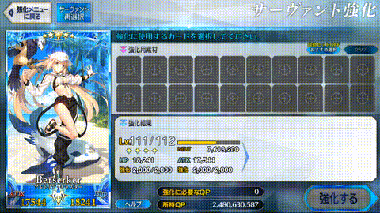

# Changelog

## Unreleased

### Breaking Changes in Unreleased

- Migration of Battle Configs' shared preferences into Protobuf backed by Proto Datastore:

    - Exported configs are now would be `.pb` instead of `.json`.
    - Importing configs now supports two formats: `.pb`(the new format) and `.json` (for the backwards compatibility).
- Preferred Servants now have been updated thanks to the migration:
    - Each servant now has its own setup (`Skills`, `Appends`, `NP Level`, etc)
    - Each servant now has local CE and friend configurations, which override the global CE and friend option.
- NP Cards and Command Cards are now explicitly shown.
    - Also added `{` and `}` at the start and end of the action cards.
    - Any `n` on the action cards denotes `command card` hence `{4n6}` is NP Servant 1, Command Card, NP Servant 3
- Multiple Scripts in the same battle config is now available.
    - UI is still basic, still working on this.

### New features in Unreleased

- Added baseline profiles, should make the startup a bit faster.
- Added Support for Leveling Append 4 and 5 for all servers
- Added Support for selecting Append 4 and 5 in Preferred Support Servant
- Added number of configs per server tab in the library

  

### Fixes in Unreleased

- Removing of battle config should not crash the battle launcher
- Duplicate keys causes error when using `CN` locale

### Misc in Unreleased

- We have moved to using the Github packages for the custom libraries that I've used. This should add an extra security at the very least with the libraries that I made.

## pre-2614

2026-06-22

### New features in pre-2614

- Battle script got its own script execution updated with scheduler.
    - BFGO NP Skip was given higher priority at certain points of time making it reliable to skip 3 NPs in a row.
    - Some parts of the battle script are turned off at certain points in time
    - Some of the screen checks are only checked every N turns during certain periods of time because they are unlikely to match.
    - The above changes should, in theory, reduce the processing power needed due to not checking all of the screen matches every time.
- Added missing image template for the Command Spell for KR/CN/TW (untested, but should work in theory)
- Added Command Card Screen detection (will be referred to as the Attack screen)
    - This is the part of the battle script where you will have to choose command cards
    - In case of a lag, the script should be able to recover using this as the starting point
- Added retry to open the attack screen.
    - Often, lag can prevent the attack screen from opening. We have added a retry mechanism for this.
- Partial Support for Android 17
- Added two new materials
    - https://apps.atlasacademy.io/db/JP/item/6564

      

    - https://apps.atlasacademy.io/db/JP/item/6565

      

- Minor performance upgrade thanks to the updated opencv to v5

### Fixes in pre-2614

- Support Image Maker was crashing because I accidentally deleted a string, re-added now.

## pre-2541

2026-05-08

### Breaking Changes in pre-2541

#### Command Card Selection

- Card Priority, Servant Priority, etc., now support turn-based configuration.
- Updated the serialization format for Card and Servant Priority. Configurations saved in this version are not backward-compatible with older versions but still maintains backward-compatibility with older versions.
- Changed the text for new wave configuration from `"
"` to `"[w]"` and added `"[t]"` for the new turn configuration.
- `Use Servant Priority` is now turned into `Enable Servant Priority`, and you can now adjust if you want servant priority or not per wave and/or turn.
- Increase card priority waves from 3 to 4

### Fixes in pre-2541

- There were some problem in UI where setting NPs causes it to be sorted out. We already address this problem
    - For technical reason, it was due to us using set instead of list causing it to lost the order, we have now moved it to List
- When users are manually navigating away from support screen while the auto battle is on, it will cause an infinite loop with the script. We have now fixed this by adding a checking the screen and exit that portion of the script when no longer in the support screen.
- We have now fixed the preferred support selection and it will now sorted the already selected supports on opening preferred support selection screen. This got broken when we migrated from manual query to using database.

    

- Fixed the Battle Launcher not updating all of the battle config data causing incorrect values on the summary screen.

### Feat in pre-2541

- Added tracking of preferred support Servants/CEs/Friends. Can show you how many time a certain preferred support got picked

    

- Added tracking of last script exit window. You can now see the results of your last script run if you accidentally closed the results fast.

    

## pre-2509

2026-04-26

### Feat in pre-2509

- Added [Prelati](https://apps.atlasacademy.io/db/JP/servant/467) to the Skill Maker

    

    

## pre-2508

2026-04-25

### Feat in pre-2508

- Added the ability to start the script at a different step of the battle script

    

    

    For the initial run, it overrides the wave and/or turn based on the wave and turn from the selected step in the battle script. Subsequent runs will follow the normal battle script flow.

#### BFGO NP Skip

- Updated NP skip detection for better FGO, new logic currently only improves the 1st NP skip detection. For further improvements of the consecutive NP Skip detection(2nd and 3rd NP still uses old logic). It is going to require a lot of work to make it work reliably so it is going to be a future update.

### Fixes in pre-2508

#### UI

- I, mistakenly, used `skill1` instead of `servant1` when I was updating the colors for skill maker commands, this caused the colors to be same for `a` `d` and `g` instead of `a` `b` and `c` and so on. This has now been revert back to older color scheme. Also took the opportunity to update the other skill command colors as well.

#### Battle

- Improve the logic for checking out of commands/off script.
- When you imported a battle script with an invalid command, running it will cause the app to crash due to the error not being catch properly. Now it will show the error message properly instead of crashing the app.

## pre-2489

2026-04-13

### Fixes in pre-2489

- Fix the infinite support screen refresh
- Fix the face card for TW, now all servers uses the new servant face card region.
- Fix the textfield UI for Support Gallery, Library and Material selection screen where the keyboard won't open for Android even though the textfield is focused.
- Fix the dialog UI for Support Gallery and Preferred Support where the background is transparent instead of solid color.
- Update the text for `stop on bond level up` to clarify that it is also includes above the selected target bond level as well.

### Feat in pre-2489

#### Support New Feat

- Added new configuration for grand servants to enable choosing if the user wants to match both CE Slot 1 and 3 or just either one of them. Selecting "Either" should match the current behavior of the main repository.

    

- Added preloading of supports at the start of battle script. This should help with the user to know if there's any problem with the support images much earlier rather than waiting until the support screen to show up and then finding out that the images are not loading.

## pre-2463

2026-03-23

### Breaking Changes in pre-2463

- Update the Battle Script Command Parser. You can now add whitespaces, tabs and new lines for better readability. All of this are going to be ignored when parsing the commands.

    

    It also reacts if you type in a wrong command right after you type

    

> [!IMPORTANT]
>
> Any existing battle scripts edited after this version will no longer be compatible with older versions of the app. If you want to use it, you gotta update to remove the whitespaces, tabs and new lines.

### Features in pre-2463

- Update Home Screen UI. Added server clock and a simple gallery list detail view of the current supports. Links in Home Screen are now displayed to users.

    

- Added the Support Gallery Screen, it was mostly for viewing support template images in the support directory. This function can also be viewed as well on Preferred Support Screen.
- On app startup, there would be once in a whole app lifecycle where it will scan of the support images in the support directory in order to ensure that the paths are up to date.
- Added Images next to Support Template Images

    

    

- On Preferred Support Screen, you can now see support's template images. This will help you when you forgot the name but remember the image like me.

    

- Battle Config got some design update as well. Notes, like edit skill command, are now happening on a separate screen for better User experience.
- The summary in Battle Launcher for the current battle config have now been updated to show all of the current settings in the battle config. It used to be few info only because I got tired to code it in.

- Storage now defaults to internal Storage unless changed by user. This gives a workaround to issues with certain devices
    - [Fate-Grand-Automata#1673](https://redirect.github.com/Fate-Grand-Automata/FGA/issues/1673)
    - [Fate-Grand-Automata#1168](https://redirect.github.com/Fate-Grand-Automata/FGA/issues/1168)
    - [Fate-Grand-Automata#999](https://redirect.github.com/ArthurKun21/FGA-Preview/issues/999)

- When the support images cannot be found. Will now throw an error, this should help when there's problems with storage permissions or if the support images are not properly extracted or not found in the storage.

- Added Servant Templates Images
    - [Omii-san](https://apps.atlasacademy.io/db/JP/servant/463)
    - [Flora](https://apps.atlasacademy.io/db/JP/servant/464)

- Added CE Templates Images
    - [Great Library of Memories](https://apps.atlasacademy.io/db/JP/craft-essence/2583)

- Added Flora option in Skill Maker

- Updated the Skill Maker UI to actually inline the movement button instead of having it on tooltip. This should make it easier to move the commands.

- APKs are now split into different architectures to reduce the APK size with a universal APK option for users who want to have all architectures in one APK. This should help with the installation of the app as well as reduce the storage used by the app.

- Battle Launcher have now been updated to include more common settings.

- Battle Launcher now uses the refill resources images for better visuals

- Added re-request of Media Projection(for screenshot) and Accessibility Service when they're lost. This problem was observed on some devices particularly on Samsung devices when the screen was turned off.

### Fixes in pre-2463

- EN have now updated its UI to the accomodate the Alignment and Attribute.

    - 

### Misc in pre-2463

- Some optimization for running scripts. This is due to updating some of the inner workings of the dependency injection which ties in the program together.

> [!NOTE]
>
> We are preparing for v2 of the Supports in the future. This will enable to download the latest support images with support for Translations. But this is going to take a lot of time so we just released the database with the current support template images.

## pre-2304

2026-01-08

### Fixes in pre-2304

- Updated the Quest Reward template image for NA server as it appears to have been updated.
- Updated the skill confirmation template image for TW server
- Fixed the repeat FP summon logic due to missing template image for 100x summon.

### Feat in pre-2304

- Added Reliquary of Departed Souls to the materials list. I actually forgot about this.
- Added fallback method for FP summon when 100x summmon isn't detected. It uses the `sell` button to determine that we are on the repeat fp summon screen.

## pre-2292

2025-12-21

### Fixes in pre-2292

- Improved the checking of storage path.

### Feat in pre-2292

- Updated the Battle Launcher colors for better visibility.
- Display the app build count in the launcher for easier tracking of versions.

### Breaking Changes in pre-2292

- Removed the NP level switch to always enable NP level detection. If you no longer want to use NP level detection change it to `Lvl 1`

## pre-2288

2025-12-19

### Feat in pre-2288

- Minor UI update to Battle Launcher and added some text hints
- Updated Party Selection to 15 for all servers
- Switched all servers to 100x FP summon
- Enabled Long Press to all servers for faster rolling

### Fixes in pre-2288

- Fixed the repeat screen to enable to repeat quest again after the UI update.

## pre-2278

2025-12-15

### Fixes in pre-2278

- Update the rank up template image for JP server as it appears to have been updated.

## pre-2273

2025-12-12

### Fixes in pre-2273

- Added a blank English strings resource file to fix localization issues for some devices.

### Feat in pre-2273

#### Lottery

- Added Gesture choice when rolling for lottery in JP Server. You can now choose between `Multi-click`, `Long Press` or `Mixed` gestures when rolling for lottery in JP server.
    - **Multi-click** is recommended from box 1 to box 10
    - **Long Press** is recommended from box 11 and onwards
    - **Mixed** alternates between Multi-click and Long Press to give more flexibility when rolling for lottery.
- Reduced the default long press for lottery duration from 20s to 10s
- Added the **long press for lottery** into the Fine-Tune settings

## pre-2267

2025-12-04

### Fixes in pre-2267

- Updated the asset lookup map to include the betterfgo keys. I forgot to add this resulting in problems with bfgo.
- Fixed the validation logic for number of cards before NP selection in Skill Maker.

## pre-2263

2025-12-04

### Fixes in pre-2263

- Caching cutout preference caused problems for some devices, reverted back to direct calls again.

## pre-2262

2025-12-03

### Fixes in pre-2262

- Apple count could go over 999, we are now fixing this by increasing the max apple count to 9,999.
- Apple count would be fixed in between 0 and 9,999.
- Import Battle configs results in some information to be lost(NP Level, Default Runs, etc) due to incorrect numeric type conversion. Fixed the conversion logic to properly parse the numbers.

### Feat in pre-2262

- We have now successfully migrated from the old Tesseract to modern PaddleOCR for our OCR operations. This now should result in more accurate readings.
- As a result of the OCR migration, NP Level Detection for EN and JP server is now a bit more reliable.
- Remove the `Use OCR on Apple Count` preference as it is no longer needed with the new OCR engine.
- Moved Order Change to the main Skill Maker screen for easier access
- Added delay(1.2 seconds) for subtitles before turn start for EN server.

Added Servant Templates Images

- [Aesc/Tonelico](https://apps.atlasacademy.io/db/JP/servant/385)
- [Sanzang](https://apps.atlasacademy.io/db/JP/servant/113)
- [Illya](https://apps.atlasacademy.io/db/JP/servant/136)
- [Izumo-no-Okuni](https://apps.atlasacademy.io/db/JP/servant/327)
- [Kuonji Alice](https://apps.atlasacademy.io/db/JP/servant/415)
- [Solomon](https://apps.atlasacademy.io/db/JP/servant/459)

Added CE Templates Images

- [Those from Chaldea](https://apps.atlasacademy.io/db/JP/craft-essence/2509)

Updated Servant Template Images

- [Chloe Avenger](https://apps.atlasacademy.io/db/JP/servant/388)
- [Castoria](https://apps.atlasacademy.io/db/JP/servant/284)
- [Douman](https://apps.atlasacademy.io/db/JP/servant/297)
- [Koyanskaya of Dark](https://apps.atlasacademy.io/db/JP/servant/334)
- [Koyanskaya of Light](https://apps.atlasacademy.io/db/JP/servant/314)
- [Lady Avalon](https://apps.atlasacademy.io/db/JP/servant/353)
- [Nero Bride](https://apps.atlasacademy.io/db/JP/servant/90)
- [Oberon](https://apps.atlasacademy.io/db/JP/servant/316)
- [Skadi Ruler](https://apps.atlasacademy.io/db/JP/servant/357)
- [Tamamo](https://apps.atlasacademy.io/db/JP/servant/62)

Updated CE Template Images

- [Painting Summer](https://apps.atlasacademy.io/db/JP/craft-essence/871)
- [Great Marshal of Magic](https://apps.atlasacademy.io/db/JP/craft-essence/1458)

> [!IMPORTANT]
>
> After the installation of the APK, you have to go to `Settings` -> `Storage` -> `Extract Default Support images`

## pre-2253

2025-11-28

### Fixes in pre-2253

- Widescreen layout at CE menu screen have been updated causing errors when trying to level CEs. Updated the layout to match the new widescreen layout.
- The updated logic for fodder CEs causes crash when there's a locked CE. Fixed the logic to guard against locked CEs.

## pre-2252

2025-11-27

### Feat in pre-2252

- Added CE Type Filter in Level CE script, also added this to the FP Launcher for better CE filtering when creating Craft Essence EXP bomb

    

    Launcher

    

    EN Dialog

    

    JP New Dialog

## pre-2249

2025-11-24

### Feat in pre-2249

- Added a favorite icon for configs marked as favorite

    

    In the Library

    

    In the Battle Launcher

### Fixes in pre-2249

- `Stop on Bond Level Up` was not working due to exception not being re-thrown after being caught.
- Restored pre-allocated Mats to ease up the memory allocation on some devices.

## pre-2245

2025-11-22

### Breaking Changes in pre-2245

- Removed Screen Recording feature to simplify the codebase and reduce maintenance overhead.

### Feat in pre-2245

- Updated the MediaProjection request to use full screen for Android 15 and above. This should help reduce issues when you click the app only option that causes problems.
- Minor optimization on loading of image assets.

## pre-2208

2025-10-15

### Feat in pre-2208

- Enabled parallel reading of the command cards. If anyone wants to bring back the one at a time go to `Fine-Tune` -> `Optimizations` -> Set `Parallel Command Card Check` to 1

    

- Switched from OCR based to template image matching for reading critical stars.
- Added new option to sort configs mark with favorite to the top

    

- Faster Support refresh, switched from time based waiting to actively checking if the refresh button is now active. It has a fallback with refresh timeout.
- `Stop on bond level up` is now enabled by default. To turned it off go to `Settings` -> `Battle` -> toggle `Stop on bond level up`

    

- Added new servant template images
    - [First Hassan](https://apps.atlasacademy.io/db/JP/servant/154)
    - [Kama](https://apps.atlasacademy.io/db/JP/servant/239)
    - [Kawakami Gensai](https://apps.atlasacademy.io/db/JP/servant/453)
    - [Li Shuwen](https://apps.atlasacademy.io/db/JP/servant/235)
- When on `Tips` screen, we have added delay on there to remove wasted image matching process.

### Fixes in pre-2208

- used the correct coroutines for optimized image loading with opencv
- Unable to load CE/Friend support if there's no ".png" extension on the config file.

## pre-2186

2025-10-01

### Fixes in pre-2186

- Update codebase and aggressively close opencv mat resources in order to decrease resources used in long run
- Updated cutout region from being calculated every time to only once per script run, now it will only reset on script end

## pre-2178

2025-09-23

> [!NOTE]
>
> This is mostly UI update

### Fixes in pre-2178

- Language picker doesn't update the app's language. Made a mistake with the setup of this last preference datastore migration.
- In AutoBattle, pausing the script will now not count the pause time into the script's runtime. Going to update all other parts of the code in the future.
- Add a retry mechanism when loading the language model for tesseract

### Features in pre-2178

- Use Material3Expressive and various UI screen update
- Use dynamic colors for Android 12 and above
- Update now to make the play button to use the app's theme
- Update the sorting configuration to make it easier to see the sorting.

    

    Library

    

    Battle Launcher

- Added Relative time to the Library

    

    You can change it from Settings -> Appearance -> `Relative Timestamps`

- Default support refresh is now 25 from 5
- Show a popup when you have preferred support selection but has empty preferred servant/CE

    

    You can click the `Return back to library` if you don't want to update.

### Chore in pre-2178

- Updated the app's architecture to make it easier to swap when protobuf migration happens in the future.

## pre-2163

2025-09-13

### Fixes in pre-2163

- When using the app for the first time, it won't launch because the storage path hasn't been set yet. This creates a circular problem, as you need to set up the storage path before the app can launch.
- Forgot to delete the config file itself and its reference as I was only deleting the in-app memory of it, resulting in the config file not being deleted at all.

## pre-2152

2025-09-10

### Fixes in pre-2152

- Stepper not updating correctly, reverted back to old behavior

### Feat in pre-2152

#### Support Servant

- Added the following servant templates for Grand Rider
    - Constantine XI
    - Medb
    - Noah
    - Summer Kriemhild
    - Taigong Wang
- Updated the following servant templates for Grand Rider
    - Reines

#### Support CEs

- Added the following ce template images
    - [Blessed Bride](https://apps.atlasacademy.io/db/JP/craft-essence/2233)
    - [Chaldea Morning](https://apps.atlasacademy.io/db/JP/craft-essence/2020)
    - [First Day of Filming](https://apps.atlasacademy.io/db/JP/craft-essence/1596)
    - [Fondant au Chocolat](https://apps.atlasacademy.io/db/JP/craft-essence/428)
    - [Foreign God](https://apps.atlasacademy.io/db/JP/craft-essence/2437)
    - [From NFF with Love](https://apps.atlasacademy.io/db/JP/craft-essence/1949)
    - [Great Detective Foumes](https://apps.atlasacademy.io/db/JP/craft-essence/1080)
    - [Inverted Rain of Mud](https://apps.atlasacademy.io/db/JP/craft-essence/1691)
    - [Needle of Sincerity](https://apps.atlasacademy.io/db/JP/craft-essence/2209)
    - [Ocean Flier](https://apps.atlasacademy.io/db/JP/craft-essence/1474)
    - [Report Check](https://apps.atlasacademy.io/db/JP/craft-essence/2052)
    - [Secret Mission](https://apps.atlasacademy.io/db/JP/craft-essence/2142)
    - [Standing beneath the Azure Sky](https://apps.atlasacademy.io/db/JP/craft-essence/1605)
    - [To the Beyond, Bereft the Snowy Blossom](https://apps.atlasacademy.io/db/JP/craft-essence/1410)
    - [Traces of Christmases Past](https://apps.atlasacademy.io/db/JP/craft-essence/1126)
    - [Wings of Manuscript](https://apps.atlasacademy.io/db/JP/craft-essence/2124)
- Updated the following ce template images
    - Aerial Drive
    - Bella Lisa
    - Black Grail
    - Blessed Bride
    - Chaldea Lunchtime
    - Chaldea Teatime
    - GudaGuda Poster Girl
    - Kaleidoscope

## pre-2148

2025-09-07

[Compare changes](https://github.com/ArthurKun21/fga-preview/compare/00ce55a1...0b5f9b64)

### Fixes in pre-2148

- Cannot select an apple, update apple count or any server related preference if you have switched from one game server(EN) to another (JP) and vice versa.
- Selected Apple's Count not being decreased if you used it.

### Feat in pre-2148

- Updated to show all of the apple counts in battle launcher
- Updated to add more buttons for easier updating of apple count

    

## pre-2146

2025-09-05

[Compare changes](https://github.com/ArthurKun21/fga-preview/compare/7e5a2fe0...00ce55a1)

### Fixes in pre-2146

- Stepper is going to take in the boundary on initialization to ensure that it wouldn't go out of bounds such as `-1` in teapots/runs/ etc
- Updated the Skill Maker to use the full width in order to display the text more clearly

    

- Make the saving of image patterns multi-thread friendly

### Feat in pre-2146

- In anticipation of the upcoming raid, added experimental raid options. Be warn that the locations are based from past data and might cause wrong click

    

    In order to change to `raid` Click the `Settings` Icon above in order to display the settings dialog

    

### Possible breaking changes in pre-2146

- We have migrated from shared preferences to Preference Datastore, while everything is working fine so far be sure to Backup your configs in case that there was a problem.

> [!IMPORTANT]
>
> Be sure to backup your configs before updating to this release. Just incase that there was a problem with the migration.
> I already used it and so far found no problem but it is still better to backup just incase.

## pre-2138

2025-08-28

[Compare changes](https://github.com/ArthurKun21/fga-preview/compare/64db6921...7e5a2fe0)

### Fixes in pre-2138

#### Teapots

- We didn't notice that the wide and ultra wide detection region are off resulting in mis-click and the quest getting stuck. We have now updated it.

#### Mighty Chain

- @Vylantze have updated the logic behind Mighty Chain

    https://redirect.github.com/Fate-Grand-Automata/FGA/pull/2087

## pre-2133

2025-08-25

[Compare changes](https://github.com/ArthurKun21/fga-preview/compare/735e550e...64db6921)

### Fixes in pre-2133

- Update the location to close the skill window during cooldown @erectorOps

#### Support Image Maker

- Added keyboard support when using mobile devices. Now it will show up.
- Fixed the Close Icon button to empty the string instead of reseting to default string
- Minor UI update with Support Image Maker, now uses full screen dialog.

  

### Features in pre-2133

#### Overlays

- Overlays are now Full screen dialog

  

- Play Button and overlay launchers will follow the system theme

  

#### Mighty Chain

- Experimental new feature: Mighty Chain by @Vylantze

  

## pre-2126

2025-08-20

[Compare changes](https://github.com/ArthurKun21/fga-preview/compare/0900ecc0...735e550e)

### Fixes in pre-2126

- Move the initialization of tesseract to its designated thread.

## pre-2124

2025-08-19

[Compare changes](https://github.com/ArthurKun21/fga-preview/compare/d0860904...0900ecc0)

### Updates in pre-2124

- Added Summer Tiamat to servant template images

> [!IMPORTANT]
>
> After the installation of the APK, you have to go to `Settings` -> `Storage` -> `Extract Default Support images`

- Increase the SDK to API Level 36(Android 16). Let me know if there are some problems.

## pre-2120

2025-08-17

[Compare changes](https://github.com/ArthurKun21/fga-preview/compare/16a1815a...d0860904)

### Fixes in pre-2120

- Not optimized initialization of Tesseract caused some devices to crash.
- We were using too much threads for Tesseract. Moved the Tesseract back with others to the service scoped threads.
- Added some excpetion handling for Tesseract and optimized the initilization of regex for reused.

### Feature in pre-2120

#### Use OCR on Apple Count

- Crash on Apple Refill screen is due to Tesseract crashing. We have now added a new option to skip the usage of OCR for more accurate reading of apples used.

  

  This is found on `settings` -> `Battle` -> `Use OCR on Apple Count`.

  In case you didn't knew, Enabling `Over Recharge AP` would use the max apples available when refilling apples instead of normally only using 1 at a time.

  

## pre-2116

2025-08-15

[Compare changes](https://github.com/ArthurKun21/fga-preview/compare/69af606a...16a1815a)

- Perform some minor UI tweaks here and there
- Updated and perform some cleanup on codebase

### Fixes in pre-2116

#### Grand Servant Tag

- Added clarification that the Grand Servant Tag currently only works on Grand Duels

  

- Updated the text of the last option to further clarify what it means.

  

#### Level Servant Script

- Fixed the "execute" button not being handled for welfare servants
- Also tested that the trial welfare servant will correctly stop the script once it reached its max level. We weren't sure due to the UI change.

#### Skill Maker

- Added Button hints for Shiki. But if you ever don't want to upgrade yet you can use Dante's options in the mean time.

  

- Added various servant icons to help you decide the button to choose. Also you can't click on that servant icons.

  

- Fixed the buttons hint are only occupying the current space, we have now made it so it can go beyond the screen. Sorry about that.

## pre-2106

2025-08-12

[Compare changes](https://github.com/ArthurKun21/fga-preview/compare/58c5ed15...69af606a)

Fixes:

### Teapots Fix in pre-2106

- It is now back to just normal turn on or off

  

- It will now always check the teapots section at party and repeat screen, if it needs to turn on or off depending if you check ✅ the usage
- If you are on the last run and you still have remaining teapots in the configuration, it will now attempt to turn it off regardless.
  This should help you ~~and me~~ to not accidentally use Teapots on non-high bond quests.
- The above condition doesn't apply to Ordeal Call Free Quest if you ran out of Storm Pods, as we have no way of turning it off once the quests ends.

### Grand Servants Fix in pre-2106

- We have updated the detection regions for both normal as well as support image maker.
- Removed the warning for `Above lvl 100` with the new updated detection region as it seems fairly consistent at Grand Duels

  

Experiment:

- We have introduced a dedicated thread to Tesseract(OCR) to check if it will improve the NP level detection. As well as we have updated its detection region.
  Let me know if it somehow improved.

## pre-2100

2025-08-10

[Compare changes](https://github.com/ArthurKun21/fga-preview/compare/eec23e1e...58c5ed15)

Fixes:
- Added support for getting support images from grand servants. You can now get the CE and Friend as support images aside from the already supported Servant

> [!Note]
> Be aware that only the **slot 1** for CEs of Grand Servant is supported for the new implementation.

## pre-2098

2025-08-10

[Compare changes](https://github.com/ArthurKun21/fga-preview/compare/11839899...eec23e1e)

Fixes:

- Accidentally flip the hiding condition for the play button resulting in play button still showing on vertical mode.
- Improve the image matching operations by removing the redundant operation cause by kotlin sequence and "also" operator

## pre-2095

2025-08-09

[Compare changes](https://github.com/ArthurKun21/fga-preview/compare/e6930503...11839899)

Fixes:

- disabling the skip filter for JP will cause an infinite loop on CE leveling, now it will always auto ON the auto fill
- Made a mistake when translating my jupyter notebook for experiment to the app code that cause incorrect detection area for searching friends with grand servants. We have now fixed it

Breaking:

- We are now removing the root screenshot feature for future improvement of codebase.

## pre-2092

2025-08-06

[Compare changes](https://github.com/ArthurKun21/fga-preview/compare/90bad108...e6930503)

Saw some reports with crashing and going to disable this for a while.

For context, this runs in the background using kotlin thread. And this might be a problem when paired with the
kotlin coroutines, which where automation scripts run with, both fighting for the same resources causing a crash.

## pre-2090

2025-08-06

[Compare changes](https://github.com/ArthurKun21/fga-preview/compare/5ef62ae8...90bad108)

Return back the `Reset All` to its old functionality and introduce a new button `Default` in which will now inherit the returning of values to their default value.

---

Fix the is Max ascended for the Grand Servants. This is causing issues the last few grand duels
if you turn it on due to the fact that it wasn't adjusted for the Grand Servants.

Notice that the `Max ascended` star is a lot lower on the Grand Servant than Normal Servant.

We have now taken into account both situations.

| Grand Servant | Normal Servant|
|:--:|:--:|
|  |  |

---

We have made a mistake in the previous logic for the Grand Servants selection.
Before even if you set it up to select Grand Servants there's a chance to select
a normal version of it.

| Grand Servant | Normal Servant|
|:--:|:--:|
|  |  |

We have now updated the logic that if you set it up to find Grand Servant it would check for Grand Servant Settings

Such Settings are any of the following:

- You have selected to find if there's Bond CE/NP Charge on Slot 2
- You have setup to find a CE on Slot 3
- You are searching for either Grand Servant Tag(Fixed lvl 100 or Lvl 100 and above)

---

The following are now added to Default Support Servants to help to the upcoming Extra 1 Grand Duel and beyond

- Mash
- Jalter
- Arcueid
- Kagetora (Ruler)
- Ciel
- BB Dubai
- U-Olga Marie

> [!IMPORTANT]
> After the installation of the APK, you have to go to `Settings` -> `Storage` -> `Extract Default Support images`

## pre-2085

2025-08-04

[Compare changes](https://github.com/ArthurKun21/fga-preview/compare/71d99215...5ef62ae8)

App was crashing when starting the script service. This is a side-effect code to fix the initialization of play button.
Due to bug in the code it causes to have negative left location causing the crash. We have now added a lower bound in order to prevent that.

---

We have copied code from Mihon's codebase in order to display some crashing issues.

---

Finally figured out what was wrong with my code and it is no longer ugly again.

## pre-2079

2025-08-03

JP have now implemented a refund window that show the extra Embers/QP. This makes the script quit due to
sharing the same window with out of ember/qp. We have now implemented a handler to hopefully handle this

[Compare changes](https://github.com/ArthurKun21/fga-preview/compare/7afa3bdd...71d99215)

## pre-2075

2025-08-01

[Compare changes](https://github.com/ArthurKun21/fga-preview/compare/1e5c8503...7afa3bdd)

## pre-2074

2025-08-01

[Compare changes](https://github.com/ArthurKun21/fga-preview/compare/18da5b64...1e5c8503)

### Updated the Support Text Information in pre-2074

Updated the UI to also display the full information including Grand Servant Configuration

Battle Configuration Screen

Battle Launcher

### Auto Send Friend Request is now per battle config in pre-2074

It has now been migrated from per server configuration into per battle configuration

Battle Configuration Screen

Battle Launcher

## pre-2061

2025-07-30

[Compare changes](https://github.com/ArthurKun21/fga-preview/compare/ee232491...18da5b64)

### Default Run configuration in pre-2061

The initial value of per item in the configuration will always be "1" but by resetting in the battle launcher it would then reset to whatever default value you inputted.

Whenever you completed your inputted number of runs, it would also reset to whatever default you have inputted instead of "1"

### Auto Level Servant for JP in pre-2061

It has now been optimized to use the newly added auto fill embers

> [!WARNING]
> Haven't tested with the temporary servants such as welfares at the time of creating this feature. As such may fail, please be advised.

### Auto Level CE for JP in pre-2061

It has now been optimized to use the newly added auto fill CEs

## pre-2055

2025-07-29

[Compare changes](https://github.com/ArthurKun21/fga-preview/compare/5f7bb6ef...ee232491)

## pre-2053

2025-07-29

[Compare changes](https://github.com/ArthurKun21/fga-preview/compare/5ca9863b...5f7bb6ef)

## pre-2052

2025-07-28

Library tabs will now display all of the servers tabs. If you want to disable some of the server tabs go to settings -> library -> library tabs and disable the ones you don't want to see.

---

There's now a new setting to disable auto stop of accessibility service when the script was stopped.

Go to settings -> advanced -> "Auto stop accessibility service on script service stop"

---

Battle script will now automatically return to menu when the script ends instead of staying on the repeat screen.

To disable it, on the battle launcher

Click Settings(Gear) -> disable "return to main screen"

[Compare changes](https://github.com/ArthurKun21/fga-preview/compare/7e2871ec...5ca9863b)

## pre-2030

2025-07-20

[Compare changes](https://github.com/ArthurKun21/fga-preview/compare/fcc603f1...7e2871ec)

## pre-2021

2025-07-17

[Compare changes](https://github.com/ArthurKun21/fga-preview/compare/b588b2bc...fcc603f1)

## pre-2014

2025-07-15

[Compare changes](https://github.com/ArthurKun21/fga-preview/compare/e2eb2b5e...b588b2bc)

## pre-2005

2025-06-20

[Compare changes](https://github.com/ArthurKun21/fga-preview/compare/6b0d9791...e2eb2b5e)

## pre-1994

2025-05-28

[Compare changes](https://github.com/ArthurKun21/fga-preview/compare/68dd1e78...6b0d9791)

## pre-1992

2025-05-28

[Compare changes](https://github.com/ArthurKun21/fga-preview/compare/726daa1f...68dd1e78)

## pre-1987

2025-05-26

[Compare changes](https://github.com/ArthurKun21/fga-preview/compare/f769d72d...726daa1f)

## pre-1978

2025-05-24

[Compare changes](https://github.com/ArthurKun21/fga-preview/compare/2f088460...f769d72d)

## pre-1972

2025-05-23

[Compare changes](https://github.com/ArthurKun21/fga-preview/compare/db35f981...2f088460)

## pre-1966

2025-05-19

[Compare changes](https://github.com/ArthurKun21/fga-preview/compare/3519489b...db35f981)

## pre-1952

2025-05-11

[Compare changes](https://github.com/ArthurKun21/fga-preview/compare/ef20a1d9...3519489b)

## pre-1948

2025-05-05

[Compare changes](https://github.com/ArthurKun21/fga-preview/compare/66c8521b...ef20a1d9)

## pre-1946

2025-05-05

[Compare changes](https://github.com/ArthurKun21/fga-preview/compare/2ae931bb...66c8521b)

## pre-1945

2025-05-05

[Compare changes](https://github.com/ArthurKun21/fga-preview/compare/f333cec8...2ae931bb)

## pre-1942

2025-05-04

[Compare changes](https://github.com/ArthurKun21/fga-preview/compare/7cf94e95...f333cec8)

## pre-1934

2025-04-29

[Compare changes](https://github.com/ArthurKun21/fga-preview/compare/105c8272...7cf94e95)

## pre-1930

2025-04-28

[Compare changes](https://github.com/ArthurKun21/fga-preview/compare/10f29abe...105c8272)

## pre-1929

2025-04-28

[Compare changes](https://github.com/ArthurKun21/fga-preview/compare/8cdffe55...10f29abe)

## pre-1921

2025-04-15

[Compare changes](https://github.com/ArthurKun21/fga-preview/compare/55fdfc05...8cdffe55)

## pre-1910

2025-04-02

[Compare changes](https://github.com/ArthurKun21/fga-preview/compare/7c4be32a...55fdfc05)

## pre-1897

2025-03-29

[Compare changes](https://github.com/ArthurKun21/fga-preview/compare/a6599f8f...7c4be32a)

## pre-1882

2025-03-24

[Compare changes](https://github.com/ArthurKun21/fga-preview/compare/230fac58...a6599f8f)

## pre-1854

2025-02-20

[Compare changes](https://github.com/ArthurKun21/fga-preview/compare/2733f065...230fac58)

## pre-1842

2025-02-17

[Compare changes](https://github.com/ArthurKun21/fga-preview/compare/2ca217d5...2733f065)

## pre-1826

2025-01-31

[Compare changes](https://github.com/ArthurKun21/fga-preview/compare/ad77672c...2ca217d5)
