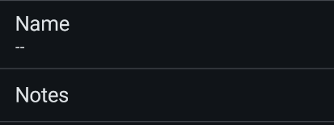
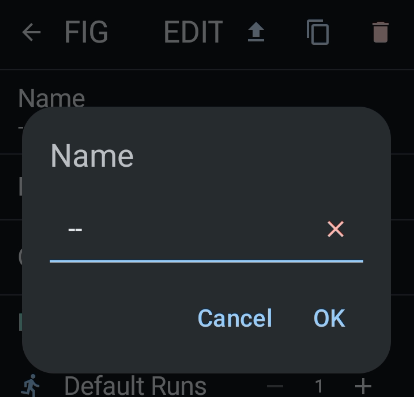
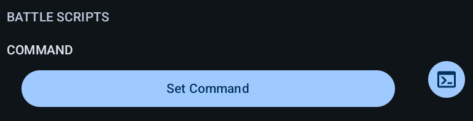
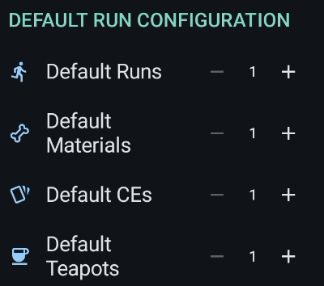
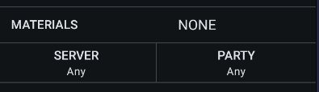
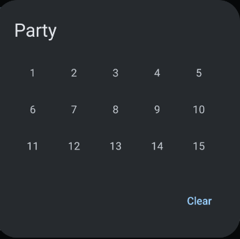
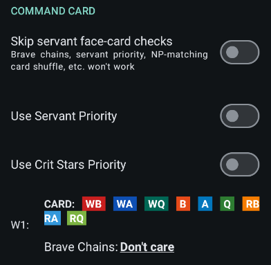
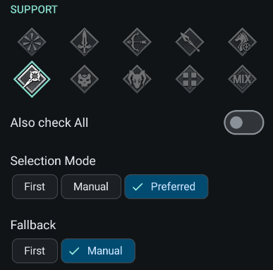
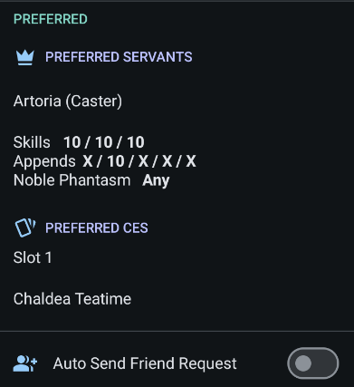

# Battle Config

A battle config stores the settings for one automated farming task. FGA reads the config when it runs battles, selects supports, and picks command cards.

## Overview

A battle config contains these groups:

| Group | What it controls |
| ----- | ---------------- |
| **General** | Name, notes, and favorite status |
| **Battle Scripts** | The skill commands that automation runs |
| **Default Run Configuration** | The starting limits for runs, CEs, teapots, and Ordeal Call pods |
| **Farming** | Materials, game servers, and the party |
| **Command Card** | The rule that picks attack cards |
| **Support** | How FGA picks a support servant |
| **Raid** | Turn delays and intro skipping for raid battles |
| **Additional Settings** | Target selection and card shuffling |
| **Records** | Read-only usage statistics |

!!! note "Changes since `pre-2614`"

    - A config can contain several battle scripts. One script is active.
    - A config can contain several named command-card rules. One rule is active.
    - The **Default Ordeal Call Pods** limit is new.
    - You can select several game servers for one config.
    - The exit settings moved into the Script Maker script list.
    - The quick edit dialog for skill commands is gone. Edit commands in the Script Maker.
    - A Records section tracks the usage of the config.

## General

| Name and Notes                                         | Name Edit Dialog                                                     |
| ------------------------------------------------------ | -------------------------------------------------------------------- |
|  |       |

- **Name** identifies the config. The name cannot be blank.
- **Notes** is multi-line text for extra information.
- **Favorite** marks the config. Favorite configs sort to the top of the config list.

Tap **Name** to open the edit dialog. Tap **Notes** to open the notes editor.

## Battle Scripts

A battle script holds the skill commands for every wave and turn. A config can contain several scripts. Automation runs only the active script.

Tap the script card to open the [Script Maker](script-maker.md). In the Script Maker you manage the script list, edit the commands, and set the start point.

## Script Exit Settings

Each battle script owns its exit settings. The Script Maker lists them at the top of the script list:

- **Out of Commands Exit** ends the battle when the script has no commands left.
- **Off-script Exit** ends the battle when the battle reaches a wave or turn that the script does not define.

See [Set Exit Settings](script-maker.md#set-exit-settings) in the Script Maker Guide.

## Default Run Configuration

| Setting                      | Description                                  | Range |
| ---------------------------- | -------------------------------------------- | ----- |
| **Default Runs**             | The number of battle loops                   | 1-300 |
| **Default CEs**              | Stop after this many Craft Essence drops     | 1-300 |
| **Default Teapots**          | Stop after using this many teapots           | 1-300 |
| **Default Ordeal Call Pods** | Stop after using this many Ordeal Call pods  | 1-9   |

The **Default** button in the [Battle Launcher](launcher.md) restores the current limits to these values. The **Reset All** button sets every limit to 1.

When the script reaches a limit, the limit turns off and its value returns to the default. Each tracked material has its own limit and default limit. Set them in the [Materials](materials.md) editor.

## Farming

- **Materials** selects the materials to track. Tap the materials card to open the [Materials](materials.md) editor.
- **Server** selects one or more game servers. The config appears only on the selected servers. No selection means every server.
- **Party** selects the party slot for battles. **Use existing** keeps the party that the game already selected.

| Setting          | Preview                                                    |
| ---------------- | ---------------------------------------------------------- |
| Party Selection  |   |

!!! info "Party Slots"
    All servers use 15 party slots.

## Command Card

A config can contain several named command-card rules. One rule is active. Automation uses the active rule to pick attack cards.

Tap the rule card to open the [Command Card Priority](card-priority.md) editor. The card shows the rule name, the notes, and a chip when **Skip servant face-card checks** is on.

!!! note "Priority options moved"
    The servant priority and critical-star priority switches are now wave and turn settings inside each rule. See [Command Card Priority](card-priority.md).

## Support Selection

Choose how FGA picks a support servant.

| General Setup                                                        | Preferred Setup                                                          |
| -------------------------------------------------------------------- | ------------------------------------------------------------------------ |
|  |  |

- **Class** selects the class tab that FGA searches first.
- **Also Check All** searches the **All** tab when FGA does not find the preferred support in the selected class.

### Selection Modes

| Mode          | Behavior                                                                |
| ------------- | ----------------------------------------------------------------------- |
| **First**     | Selects the first support in the list.                                  |
| **Manual**    | Waits on the support screen. You select the support yourself.           |
| **Preferred** | Searches for your preferred servants or Craft Essences.                 |

By default, FGA continues the script after you select a support. Enable **Exit on Manual Support Selection** in the app settings to pause the script instead. Then resume the script manually.

### Preferred Mode Options

When you select **Preferred** mode:

- **Fallback** is the selection mode that FGA uses when the preferred support is not found. Choose **First** or **Manual**.
- **Enable Send Friend Request** is the master switch for sending friend requests. See [Support](support.md).
- **Preferred Support** is the summary of your preferred servants and default Craft Essence. Tap it to open the [Support](support.md) editor.

!!! note "Preferred mode needs a criterion"
    Preferred mode needs at least one enabled servant or a configured default Craft Essence. FGA shows a warning when the config has none.

## Raid Settings

Special options for raid battles like Tunguska or event raids:

| Setting            | Effect                                                     |
| ------------------ | ---------------------------------------------------------- |
| **Raid Delay**     | Adds a delay before the first action                       |
| **Delay Duration** | Wait time in seconds (1-10)                                |
| **Skip Intro**     | Skips story introductions. This setting is experimental.   |

!!! tip "Why Use Raid Delay?"
    Some raid battles show kill counters that interfere with FGA's timing. Adding a delay allows the overlay to disappear before FGA starts acting.

    

## Additional Settings

| Setting                | Effect                                                       |
| ---------------------- | ------------------------------------------------------------ |
| **Auto Choose Target** | Targets the first Danger or Servant enemy                    |
| **Shuffle Cards**      | The condition that re-deals the command cards                |
| **Wave**               | The wave that triggers the shuffle (1-3)                     |

Shuffle conditions:

| Option                  | Condition                                                     |
| ----------------------- | ------------------------------------------------------------- |
| **None**                | Never shuffle cards.                                          |
| **No effective cards**  | The hand has no card that is effective against the enemies.   |
| **No cards matching NP**| The hand has no card that matches the Noble Phantasm.         |

The **Wave** stepper appears when you select a shuffle condition other than **None**.

## Records

You cannot edit the Records section. FGA updates it after each battle session:

| Item                 | Description                                          |
| -------------------- | ---------------------------------------------------- |
| **Usage Count**      | How many runs FGA completed with this config         |
| **Total Usage Time** | The total battle time for this config                |
| **Last Used**        | When FGA last used this config                       |

## Config Management

Use the top bar of the config editor:

- **Copy** creates a duplicate of this config.
- **Delete** deletes this config. FGA opens a dialog before the deletion.

The more options menu contains:

- **Export** saves the config as a JSON file for backup or sharing.
- **Summary** opens a read-only summary of every setting. You can also switch the active script and the active command-card rule there.
- **View Raw Data** shows the raw JSON of the config. Tap **Copy** to copy it to the clipboard.

## Tips for Best Results

1. **Start simple** - Create basic configs first, then add complexity as needed
2. **Use descriptive names** - Include the quest name and farming target (for example, "Doors - QP Farming")
3. **Test your scripts** - Run the quest once manually before a long farming session
4. **Set realistic limits** - Match run counts to your available AP and apples
5. **Prepare Preferred mode** - Add at least one criterion and set a fallback for when friends are unavailable

## Troubleshooting

### Config shows on wrong server

Select the servers for this config with the **Server** option. Clear every server to use the config on all servers.

### Scripts do not execute correctly

Open the [Script Maker](script-maker.md) and check the command sequence for each wave and turn. Check that the wave timings match the enemy counts.

### Support selection fails

- Add at least one preferred servant or Craft Essence
- Check servant and CE images in the [Support Setup](support.md)
- Enable **Also Check All** to search additional tabs
- Set a fallback option for when preferred supports are unavailable

### Battle exits unexpectedly

Check the exit settings in the [Script Maker](script-maker.md):

- Disable **Out of Commands Exit** if you want FGA to continue with card selection
- Disable **Off-script Exit** if battles may have variable turn counts
