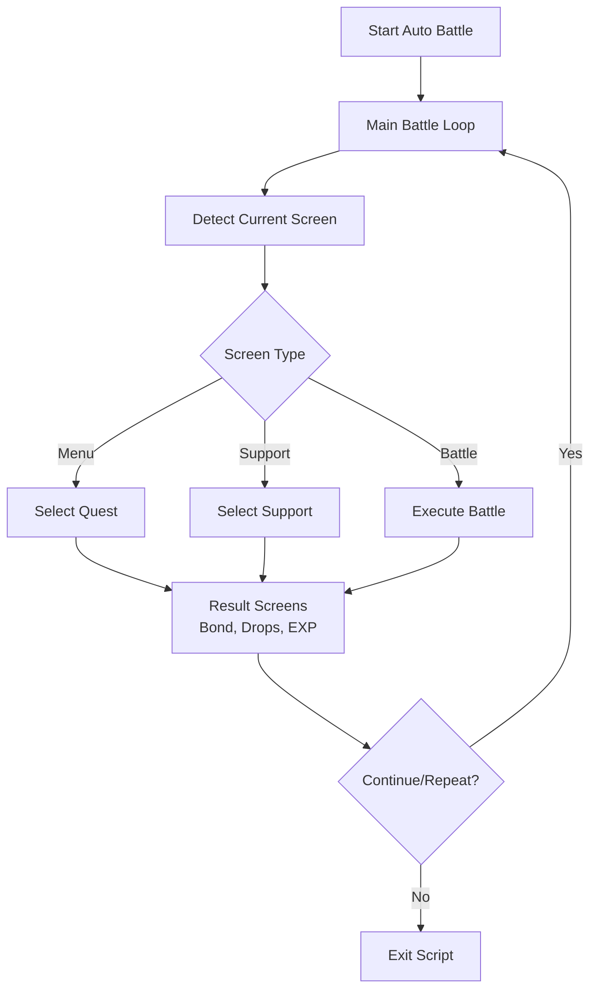

# Auto Battle

The Auto Battle script farms quests in Fate/Grand Order. It runs the complete quest loop from support selection to the result screens.

## Overview

Auto Battle is the primary farming script. It manages the full quest cycle:

- Support selection
- Battle execution with your skill commands and card priorities
- Reward screens
- Quest repetition until a stop condition applies

You can pause the script at any time. The script can also pause itself. Example: manual support mode waits until you select a support. The pause screen shows the run statistics and the commands that the script has not executed yet.

## How to Start

1. Open the **Quest Selection** screen for the quest that you want to farm.
2. Configure a **Battle Config** with your skill commands and card priorities.
3. Start the script.

The script detects the current screen and continues from it. It recognizes these states:

- The menu icon is visible (quest selection screen)
- The support selection screen is open
- A battle is in progress

!!! tip "Important"
    Configure skill commands before you start. The script exits if it cannot parse the commands.

## Workflow



## Key Features

### Support Selection

- Selects the support servant from your configured preferences
- Selection modes: Manual, First, Friend, and Preferred
- Refreshes the support list when the preferred support is not found
- Pauses in Manual mode and waits until you select a support
- See [Selection Modes](../support-screen/selection-modes.md) for details

### Battle Execution

- Executes your skill commands wave by wave
- Selects cards from your priority settings
- Supports Noble Phantasm chains and brave chains
- Handles Order Change (servant swaps)
- See [Skill Execution](skill-system/skill-execution.md) for details

### Command Execution Start From

- The battle setup can set a start point inside the selected battle script
- The script skips all commands before the start point in the first run
- The start point resets after a completed run
- The next session then starts from the first command

### Pause and Resume

- Pauses when you request it, and when manual support mode waits for you
- The pause screen shows the run statistics and the remaining skill commands
- The remaining commands appear per wave and turn
- The script removes each command from the list after it runs
- Resuming continues the script at the same point

### AP Refill (Apples)

- Refills AP automatically with your configured apples
- Supports all apple types (gold, silver, bronze, copper, saint quartz)
- Refill limits are configurable
- Can wait for AP regeneration
- See [Energy Refill](resources/energy-refill.md) for details

### Card Selection

- Reads and selects the command cards
- Sorts face cards by priority, per wave and turn
- Considers the critical star percentage
- See [Face Card Priority](card-selection/face-card-priority.md) for details

### Chain Priority and Custom Cards

- An ordered list of chain types per wave and turn
- Exact three-card picks that bypass the sort and the chain rules
- See [Chain Priority](card-selection/chain-priority.md) and [Custom Card Priority](card-selection/custom-card-priority.md) for details

### Card Simulation

- Shows a sample hand with the real selection pipeline
- Shows the pick, the ranked results, and a step-by-step decision trace
- See [Card Simulation](card-selection/card-simulation.md) for details

### Brave Chain Optimization

- Four brave chain settings: Don't care, With NP, Always, Avoid
- Rearranges cards for more damage
- Combines Noble Phantasms with matching face cards
- See [Brave Chains](card-selection/brave-chains.md) for details

### Support Picks Tracking

- Records each picked preferred support: servants, Craft Essences, and friends
- The exit summary and the pause screen show the picks with counts

### Material Tracking

- Tracks the materials that drop during farming
- Can stop when the material count reaches the target
- Screenshots the drops for reference
- See [Materials Tracking](tracking/materials-tracking.md) for details

### CE Drop Tracking

- Detects Craft Essence drops
- Can stop when a CE drops
- Tracks the total CE drop count
- See [CE Drops](tracking/ce-drops.md) for details

### Auto Target Selection

- Detects danger indicators (!) on enemies
- Detects servant enemies (crown icon)
- Targets dangerous and servant enemies first
- See [Auto Target](skill-system/auto-target.md) for details

### Run Limiting

- Run limit is configurable
- Reduces the remaining run count automatically
- Stops when the script reaches the limit

### Teapot Management

- Turns the Stargazer's Teapot on and off for a Bond Gained x2 bonus
- Manages teapot usage at the party screen and the repeat screen
- See [Teapots](resources/teapots.md) for details

### Storm Pod Management

- Turns the Ordeal Call Storm Pods on and off for bonus "Sand of Starlight" drops
- Shares the management workflow with the teapots
- Counts the pods at the Ordeal Call quest end screen
- See [Storm Pods](resources/storm-pods.md) for details

## Settings

| Setting                        | Description                                |
| ------------------------------ | ------------------------------------------ |
| Skill Command                  | Commands for skill usage per wave          |
| Command Execution Start From   | First command of the battle script to run  |
| Card Priority                  | Priority order for card selection          |
| Party Selection                | Which party slot to use                    |
| Support Selection              | How to select the support servant          |
| Limit Runs                     | Enable run limit                           |
| Run Count                      | Maximum number of runs                     |
| Refill with Apples             | Enable AP refill                           |
| Apple Type                     | Which apple types to use                   |
| Stop on CE Get                 | Stop when a CE drops                       |
| Stop on First Clear            | Stop on first clear rewards                |
| Stop on Bond Level Up          | Stop when the script reaches the bond target |
| Bond Level Target              | Target bond level to stop at               |
| Boost Item Selection           | Which boost item to use (events)           |

## Exit Reasons

The script stops and sends a notification when one of these conditions occurs:

### Normal Completion

| Exit Reason             | Description                                     |
| ----------------------- | ----------------------------------------------- |
| **Limit Runs**          | The script reached the configured run limit     |
| **Limit CEs**           | The script reached the CE drop limit            |
| **Limit Materials**     | The script reached the material drop limit      |
| **CE Get**              | A Craft Essence dropped (if stop on CE enabled) |
| **First Clear Rewards** | The script detected the first clear rewards (if stop enabled) |
| **Bond Level Reached**  | The script reached the target bond level        |
| **Stop After This Run** | User requested stop after current run           |

### Resource Depletion

| Exit Reason               | Description                                |
| ------------------------- | ------------------------------------------ |
| **AP Ran Out**            | No more AP and refill not possible/allowed |
| **Inventory Full**        | Servant/CE inventory is full               |
| **Out of Command Spells** | No command spells available when needed    |

### Configuration Issues

| Exit Reason                             | Description                                                  |
| --------------------------------------- | ------------------------------------------------------------ |
| **Support Selection Preferred Not Set** | Preferred support not configured                             |
| **Skill Command Parse Error**           | Invalid skill command syntax                                 |
| **Card Priority Parse Error**           | Invalid card priority configuration                          |
| **Missing Support Image**               | Image for a preferred servant, Craft Essence, or friend missing |
| **Withdraw Disabled**                   | Tried to withdraw but option disabled                        |
| **Preset Quest**                        | Preset quest detected                                        |

!!! note "Manual support mode"
    Manual support selection does not exit the script. The script pauses and waits until you select a support. See [Pause and Resume](#pause-and-resume).

### Special Conditions

| Exit Reason                 | Description                         |
| --------------------------- | ----------------------------------- |
| **Duplicate CE**            | Duplicate CE detected in party (JP) |
| **Daily Reset**             | Game daily reset occurred           |
| **Exit on Out of Commands** | Ran out of configured commands      |
| **Exit on Off Script**      | Script was turned off               |

### User Actions

| Exit Reason    | Description                     |
| -------------- | ------------------------------- |
| **Abort**      | Script manually stopped by user |
| **Paused**     | Script is paused                |
| **Unexpected** | An unexpected error occurred    |

See [Exit Reasons](script-control/auto-battle-exit-reasons.md) for detailed explanations of each exit condition.

## Exit State Summary

After the script completes, you receive detailed statistics:

```text
┌─────────────────────────────────────────┐
│         Battle Exit State Summary       │
├─────────────────────────────────────────┤
│ Times Ran: X                            │
│ Run Limit: Y (if enabled)               │
│ Times Refilled: Z                       │
│ Refill Limit: W                         │
│ CE Drop Count: N                        │
│ Materials: {material: count, ...}       │
│ Support Picks: {name: count, ...}       │
│ Teapots Used: T                         │
│ Storm Pods Used: P (if used)            │
│ Withdraw Count: V                       │
│ Total Time: HH:MM:SS                    │
│ Average Time Per Run: MM:SS             │
│ Min Turns Per Run: A                    │
│ Max Turns Per Run: B                    │
│ Average Turns Per Run: C.D              │
└─────────────────────────────────────────┘
```

While the script is paused, the pause screen shows the same statistics. It also shows the remaining skill commands for each wave and turn.

## Usage Records

The script writes usage records to the selected battle config. This happens after an exit with at least one completed run:

- Last usage date (UTC)
- Total run count
- Total usage time

## Workflow with Battle Execution

```text
┌─────────────────────────────────────────┐
│            Battle Wave Start            │
└─────────────────────┬───────────────────┘
                      │
                      ▼
┌─────────────────────────────────────────┐
│    Execute Configured Skill Commands    │
│    (Master skills, Servant skills)      │
└─────────────────────┬───────────────────┘
                      │
                      ▼
┌─────────────────────────────────────────┐
│    Select Cards Based on Priority       │
│    (NP, Brave chains, card types)       │
└─────────────────────┬───────────────────┘
                      │
                      ▼
┌─────────────────────────────────────────┐
│         Wait for Wave to End            │
└─────────────────────┬───────────────────┘
                      │
                      ▼
              Next Wave or Results
```

## Tips for Best Results

1. Test your skill commands before a long farming session.
2. Set card priorities that match your farming strategy.
3. Use run limits to prevent accidental over-farming.
4. Enable screenshots to keep records of drops and bond levels.
5. Configure refill limits to control apple usage.
6. Check the support settings before you start.
7. Leave inventory space for drops.
8. Use Command Execution Start From to start at a later command when you test a battle script.

## Server Support

All FGO servers work. Some features depend on the server:

- **JP/EN**: Full inventory full detection
- **KR**: Inventory full detection
- **JP**: Duplicate CE detection, Ordeal Call support
- **BetterFGO**: NP skip support

## Technical Notes

- The main loop checks more than 20 screen states
- A scheduler controls how often each check runs. Checks for the current screen state run more often than the others
- The loop waits 0.5 seconds between checks
- The script retries the connection automatically after network problems
- The script tracks run statistics: runs, time per run, and turns per run
- The script reduces the configured limits automatically after each exit

## Related Documentation

### In-Battle Features

- [Skill Execution](skill-system/skill-execution.md) - How skills are cast during battle
- [Face Card Priority](card-selection/face-card-priority.md) - Card selection priorities
- [Chain Priority](card-selection/chain-priority.md) - Ordered chain types
- [Custom Card Priority](card-selection/custom-card-priority.md) - Exact three-card picks
- [Card Simulation](card-selection/card-simulation.md) - Test card selection without the game
- [Brave Chains](card-selection/brave-chains.md) - Brave chain optimization
- [Auto Target](skill-system/auto-target.md) - Automatic enemy targeting
- [Shuffle Cards](card-selection/shuffle-cards.md) - Card shuffling options
- [Servant Tracking](tracking/servant-tracking.md) - Tracking servants on field
- [Stage Tracking](tracking/stage-tracking.md) - Wave/stage detection
- [Party Selection](script-control/party-selection.md) - Party slot selection
- [Energy Refill](resources/energy-refill.md) - AP refill management
- [Materials Tracking](tracking/materials-tracking.md) - Drop tracking
- [CE Drops](tracking/ce-drops.md) - CE drop detection
- [Teapots](resources/teapots.md) - Stargazer's Teapot bond bonus
- [Storm Pods](resources/storm-pods.md) - Ordeal Call storm pod drops
- [Withdraw](script-control/withdraw.md) - Battle withdrawal
- [Screen Detection](script-control/screen-detection.md) - Screen state detection
- [Exit Reasons](script-control/auto-battle-exit-reasons.md) - Exit conditions

### Support Screen Features

- [Selection Modes](../support-screen/selection-modes.md) - Support selection modes
- [Preferred Servant](../support-screen/preferred-servant.md) - Servant preference settings
- [Preferred CE](../support-screen/preferred-ce.md) - CE preference settings
- [Preferred Friend](../support-screen/preferred-friend.md) - Friend preference settings
- [Class Picker](../support-screen/class-picker.md) - Class filtering
- [Grand Servant](../support-screen/grand-servant.md) - Grand servant support
- [Refresh](../support-screen/refresh.md) - Support list refresh
