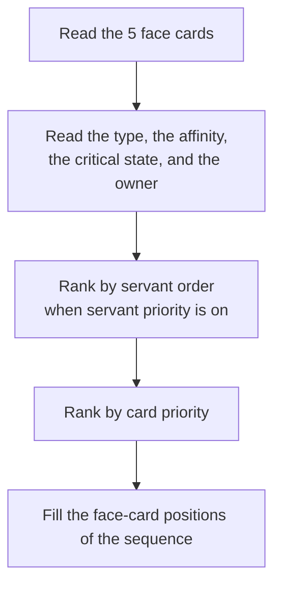

# Face Card Priority System

Face card priority is the order in which FGA ranks the five command cards on the attack screen.

## Overview

FGA reads the five face cards on the attack screen, then ranks them with your settings. It fills the face-card positions of the attack sequence from the top of that ranking.

Each command-card rule keeps its own settings for every wave and turn. One turn can use a different card order, a different servant order, and a different critical setting from the next turn.

In `pre-2614`, card priority was a single list of two-letter codes, and the critical-star and servant-priority switches were config-wide. Now each card has a three-letter code, and both switches belong to a single wave and turn.

## Key Features

- **Card type order**: rank Buster, Arts, and Quick cards.
- **Affinity order**: put cards with a class advantage first.
- **Critical variants**: rank critical and non-critical cards separately.
- **Servant order**: group the cards by servant before you rank them.
- **Per-turn switches**: the critical and servant settings belong to one wave and turn.

## How Card Selection Works



## The Card Code

Each item in the card priority list is a code of three letters.

### First Letter: Affinity

| Letter | Affinity | Effect |
| ------ | -------- | ------ |
| **W** | Weak | The servant has a class advantage. Damage increases. |
| **N** | Normal | The classes are neutral. Damage does not change. |
| **R** | Resist | The servant has a class disadvantage. Damage decreases. |

### Second Letter: Card Type

| Letter | Type | Main use |
| ------ | ---- | -------- |
| **B** | Buster | Damage |
| **A** | Arts | NP gauge charge |
| **Q** | Quick | Critical stars |

### Third Letter: Critical State

| Letter | State | Meaning |
| ------ | ----- | ------- |
| **C** | Critical | The card can deal a critical hit. |
| **N** | Non-critical | The card cannot deal a critical hit. |

A resist card has no critical variant. FGA reads a resist card as non-critical.

### Code Examples

| Code | Meaning |
| ---- | ------- |
| **WBC** | Weak Buster, critical |
| **WBN** | Weak Buster, non-critical |
| **NQC** | Normal Quick, critical |
| **RAN** | Resist Arts |

## The Default Order

A new turn starts with a list of nine cards. This is the order from the highest rank to the lowest rank:

```text
WBN, WAN, WQN, NBN, NAN, NQN, RBN, RAN, RQN
```

The order does three things:

1. It puts the cards with a class advantage first.
2. It puts the neutral cards next.
3. It puts the resist cards last.

## Critical Star Priority

The **Use Critical Star Priority** switch controls the critical variants of the cards. The switch belongs to one wave and turn, and not to the whole config.

Turn the switch off, and the list holds nine non-critical cards. Turn the switch on, and FGA adds the critical variant of each weak card and each normal card. FGA puts each critical variant directly above its non-critical twin. The list then holds 15 cards:

```text
WBC, WBN, WAC, WAN, WQC, WQN, NBC, NBN, NAC, NAN, NQC, NQN, RBN, RAN, RQN
```

A card list holds at most 15 items. An item closer to the start of the list has a higher rank.

### When to Turn the Switch On

| Your team | Recommendation |
| --------- | -------------- |
| Makes many stars | Turn the switch on |
| Makes few stars | Turn the switch off |

FGA reads the star percentage on each card, so the switch adds work to each turn.

## A Complete List

FGA always works with a full list of known cards. A list holds at most 15 items, and FGA puts back every known card that you leave out.

FGA builds the full list by these rules:

1. It drops the items with an unknown card type.
2. It drops the duplicate items.
3. It puts a missing non-resist card above the resist cards.
4. It puts a missing resist card at the end of the list.

You can move a resist card to the bottom of the list, but you cannot take it out. This keeps the list complete.


## Servant Priority

The **Use Servant Priority** switch is also a setting of one wave and turn. Turn the switch on to group the cards by servant before you rank them.

### Team Slots

FGA names each servant by its position in your party.

| Position | Servant |
| -------- | ------- |
| **1** | First servant in the party |
| **2** | Second servant |
| **3** | Third servant |
| **4** | First backup |
| **5** | Second backup |
| **6** | Third backup |

The servant list holds all six positions. FGA adds the positions that you leave out at the end of your list, so the list always covers the full party.

### How the Sort Works

Turn servant priority off, and FGA sorts only by the card code. Two cards with the same code then sort by critical percentage, and the higher percentage comes first.

Turn servant priority on, and FGA sorts in this order:

1. The position of the servant in your servant list.
2. The card code.
3. The critical percentage.

Cards that FGA cannot rank stay at the end of the list.

### Example

```text
Servant list: 3, 1, 2
Card order: Buster, Arts, Quick

Hand:
Servant 1 has Arts and Buster.
Servant 2 has Quick.
Servant 3 has Buster and Arts.

Result: Servant 3 Buster, Servant 3 Arts, Servant 1 Buster, Servant 1 Arts, Servant 2 Quick
```

## Card Chain Bonuses

Three cards of one type give a bonus. FGA can also try to form these chains in a set order. See [Chain Priority](chain-priority.md).

| Chain | Bonus |
| ----- | ----- |
| Buster | Attack increases for all cards |
| Arts | NP gauge increases for all servants |
| Quick | You get more critical stars |

## Troubleshooting

### The order is not the order that I set

- Check that you edit the wave and turn that the battle uses.
- Check the **Use Servant Priority** switch. The servant order comes before the card order.
- Check the **Use Critical Star Priority** switch. The switch changes the length of the list.
- Check the card code. A code of three letters must match a real card.

### My best card comes last

A resist card stays in the list. Move it to the bottom of the list instead of trying to take it out. See [A Complete List](#a-complete-list).

### FGA clicks a card that I rank low

FGA can change the order after the sort. The chain rules and the rearrange rule both move cards. Open **Simulation** on the turn to read each step. See [Card Simulation](card-simulation.md).

### FGA clicks a card that I did not rank at all

Check that a custom pick does not match the hand. A matching pick replaces the sort. See [Custom Card Priority](custom-card-priority.md).

## Related Documentation

- [Chain Priority](chain-priority.md) - The ordered chain rules
- [Custom Card Priority](custom-card-priority.md) - Exact three-card picks
- [Brave Chains](brave-chains.md) - Same-servant chains
- [Card Simulation](card-simulation.md) - Test a hand without the game
- [Command Card Priority](../../battle-setup/card-priority.md) - The rule editor
