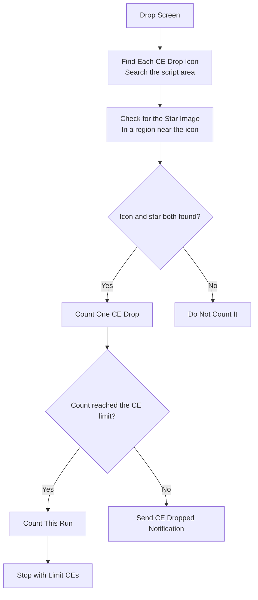

# CE Drop Detection and Tracking

FGA can find Craft Essence drops on the drop screen. This page tells you how the check works.

## Overview

FGA counts the Craft Essence (CE) drops that occur in your quest. You can set a CE drop limit that stops the script.

A separate app setting named Stop on CE GET also stops the script. That setting reads a different screen. See [Stop on CE GET](#stop-on-ce-get) on this page.

## Key Features

- **Two-stage check**: FGA finds the CE icon, then checks for the star image near it.
- **Session count**: FGA adds each drop that passes both stages to a session total.
- **Drop limit**: FGA stops the script when the count reaches your CE limit.
- **Immediate alert**: FGA sends a `CE Dropped!` notification for each drop that does not stop the script.
- **Auto-decrement**: FGA reduces the CE limit when the session ends.

## How CE Detection Works



## Detection Method

### Two-Stage Verification

FGA uses two stages to prevent a wrong count.

#### Stage 1: Find the CE Icon

FGA searches the whole script area for the CE drop icon image.

#### Stage 2: Check for the Stars

For each CE icon that FGA finds, FGA checks a small region near that icon for the star image. FGA counts a CE drop only when it finds both images.

This two-stage check prevents a wrong count of other items.

## Configuration

You set the CE limit in the Battle Config and in the Battle Launcher.

| Setting         | What it does                                                              |
| --------------- | ------------------------------------------------------------------------- |
| **CEs** switch  | Turns the CE drop limit on or off. The switch is in the Battle Launcher.  |
| **CEs** stepper | Sets the number of CE drops that stops the script. The range is 1 to 999. |
| **Default CEs** | Sets the CE limit that FGA restores after the count reaches zero.         |

See [Default Run Configuration](../../battle-setup/config.md#default-run-configuration) to set the default CEs value.

## What FGA Counts

FGA counts only the drops that pass both stages. FGA keeps one total for the whole session. The total increases each time FGA finds a CE drop.

## Limit Behavior

FGA compares the session count with the CE limit after each run.

1. When the count reaches the CE limit, FGA counts the current run.
2. FGA then stops the script.
3. The exit reason is `Limit CEs`. The exit screen shows the number of CEs that dropped.

## Notifications

FGA sends a `CE Dropped!` notification for each drop, except the drop that reaches the limit. When the count reaches the limit, FGA stops the script and does not send that notification.

## Auto-Decrement

FGA reduces the CE limit one time when the script stops. FGA does this only when the CE limit is on.

1. FGA subtracts the session count from the CE limit.
2. When the CE limit reaches zero or less, FGA turns the CE limit off.
3. FGA then restores the CE limit to the default CEs value.

```text
Before the session:
- CE Limit: 10

Drops in the session:
- CEs: 3

After the session:
- CE Limit: 7
```

## Exit Summary

The exit screen shows the total number of CEs that dropped in the session.

```text
┌─────────────────────────────────────────┐
│         Battle Exit Summary             │
├─────────────────────────────────────────┤
│ CE Drop Count: 3                        │
│ ...                                     │
└─────────────────────────────────────────┘
```

## Exit Reasons

### Limit CEs

```text
Exit Reason: Limit CEs (Count: 3)

FGA stopped because the CE drop count
reached the CE limit that you set.
```

### CE GET

```text
Exit Reason: CE GET

FGA stopped because a Craft Essence dropped
and the Stop on CE GET setting is on.
```

## Stop on CE GET

Stop on CE GET is a separate app setting. It is not the CE drop limit.

Stop on CE GET reads the CE reward screen after a quest. When the setting is on and a CE reward occurs, FGA stops the script with the `CE GET` reason. When the setting is off, FGA sends a `CE GET!` notification and continues.

This setting is experimental. It applies to first-clear rewards and Bond CEs. You set it in Global Battle Settings. See [Stop on CE get](../../app/global-battle.md#stop-on-ce-get).

## Tips for Best Results

1. **Know the drop rate**: CE drops are rare. Set a limit that matches your goal.
2. **Use it for event CEs**: The limit is most useful for limited event drops.
3. **Keep the alert on**: The `CE Dropped!` notification tells you about each drop.
4. **Let the drop screen load**: Wait until the drop screen shows all items.

## Common CE Farming Scenarios

### Event CE Farming

- Set the CE limit to the number of copies that you want.
- Keep the notification on to get an alert for each drop.
- Count the copies that you need for a Max Limit Break (five copies).

### Story CE Farming

- The drop rate is low. Set a low limit.
- The number of runs can be large.

### Random Drop CEs

- The drop rate is very low.
- Leave the CE limit off and read the exit summary after some runs.

## CE Drops and Material Drops

| Feature      | CE Drops                   | Materials                   |
| ------------ | -------------------------- | --------------------------- |
| Detection    | CE icon, then star image   | Material image              |
| Counting     | One total for the session  | One total for each material |
| Limit        | CE drop limit (CEs)        | Count of each material      |
| Alert        | `CE Dropped!` notification | Exit summary                |

See [Materials and Drop Tracking](materials-tracking.md) for material tracking.

## Troubleshooting

### FGA does not count a CE drop

1. Make sure that the full drop screen is on the screen.
2. Make sure that the CE icon and the star image are both visible.

### The count seems wrong

The two-stage check reduces wrong counts. If the count is still wrong, make sure that no other item looks the same.

### FGA does not send a notification

1. Check the notification settings on your device.
2. Make sure that the app can send notifications.
3. FGA does not send a notification for the drop that reaches the limit.

### FGA does not stop at the limit

1. Make sure that the CEs switch is on in the Battle Launcher.
2. Make sure that the CE limit is more than zero.
3. Make sure that you use the correct battle config.

## Related Documentation

- [Materials and Drop Tracking](materials-tracking.md) - Track material drops
- [Battle Config](../../battle-setup/config.md) - Full battle configuration
- [Battle Launcher](../../battle-setup/launcher.md) - Change the limits before a run
- [Stop on CE get](../../app/global-battle.md#stop-on-ce-get) - The Stop on CE GET setting
- [Exit Reasons](../script-control/auto-battle-exit-reasons.md) - Read the exit summary
- [Auto Battle](../auto-battle.md) - Overall battle automation
