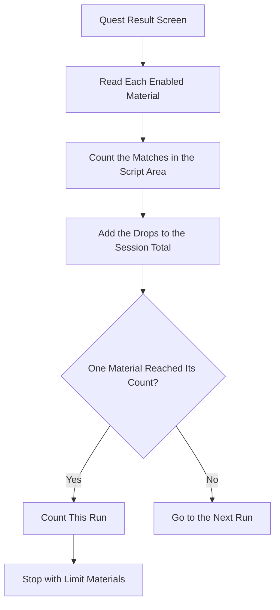

# Materials and Drop Tracking

FGA counts the materials that drop in your quest. This page tells you how the count works.

## Overview

FGA tracks the materials that you select in the Materials screen. FGA counts the drops of each enabled material. FGA stops the script when the drops of one material reach that material's count.

You set the materials and the counts in the Materials screen. See [Materials Selection](../../battle-setup/materials.md).

## Key Features

- **Per-material count**: Each material has its own count and its own default count.
- **Enabled materials only**: FGA scans a material only when you turn it on.
- **Running total**: FGA adds the drops of each run to a session total.
- **Stop at the limit**: FGA stops the script when one material reaches its count.
- **Auto-decrement**: FGA reduces each count when the session ends.
- **Exit summary**: The exit screen shows the total of each material.

## How Material Tracking Works



## Configuration

You set the materials and the counts in the Materials screen. See [Materials Selection](../../battle-setup/materials.md) for the full steps.

Each tracked material stores three values.

| Value             | What it does                                                                  |
| ----------------- | ----------------------------------------------------------------------------- |
| **Count**         | The number of drops that FGA must still find for this material.               |
| **Default Count** | The count that FGA restores after this material reaches zero.                 |
| **Enabled**       | Whether FGA counts this material. FGA does not scan a material that is off.   |

You can also change the count and turn a material on or off in the Battle Launcher. The Battle Launcher shows the material limits of the selected battle config.

## What FGA Counts

FGA scans only the materials that you turn on. FGA does not count a material that is off. FGA does not stop the script for a material that is off.

FGA does not add the counts of all materials together. FGA uses the count of each material by itself.

## How Detection Works

FGA reads the drop screen after each run. For each enabled material, FGA does these steps:

1. FGA loads the image for that material.
2. FGA searches the whole script area for that image.
3. FGA counts how many times the image occurs.
4. FGA adds that number to the session total for that material.

The search uses the full script area. More materials add more work to each drop screen.

## Track Many Materials

FGA can track many materials at the same time. Here is one example.

```text
Configured Materials:
- Bone
- Void Dust
- Hero's Proof

After 5 runs:
Bone: 12
Void Dust: 8
Hero's Proof: 15
```

## Limit Behavior

FGA keeps a session total for each enabled material. After each run, FGA compares each total with the count of that material.

1. When the session total of one material reaches its count, FGA counts the current run.
2. FGA then stops the script.
3. The exit reason is `Limit Materials`.

The number in the exit reason is the total of all materials that you collected in the session. This total includes every enabled material, not only the material that reached its count.

## Auto-Decrement

FGA reduces the counts one time when the script stops. FGA does this for every stop: a limit, the run count, a manual stop, or a pause.

1. FGA subtracts the session total of each material from that material's count.
2. When a count reaches zero or less, FGA turns that material off.
3. FGA then restores that material's count to its default count.

The count keeps your progress for the next session. This helps you farm toward a total goal across many sessions.

```text
Before the session:
- Bone count: 50

Drops in the session:
- Bone: 15

After the session:
- Bone count: 35
```

When a count reaches zero, FGA turns that material off and restores its count to the default count. You must turn the material on again to track it.

## Exit Summary

The exit screen shows the total of each material that you collected in the session.

```text
┌─────────────────────────────────────────┐
│         Battle Exit Summary             │
├─────────────────────────────────────────┤
│ Materials:                              │
│   Bone: 23                              │
│   Void Dust: 18                         │
│   Hero's Proof: 31                      │
└─────────────────────────────────────────┘
```

The exit screen shows a material only when its total is more than zero.

## Material Rarity

FGA sorts materials into three rarities. The Materials screen uses one tab for each rarity.

| Tab        | Materials in this tab                                                          |
| ---------- | ------------------------------------------------------------------------------ |
| **Copper** | Proofs, bones, fangs, dust, and similar common items.                          |
| **Silver** | Seeds, feathers, gears, pages, and class pieces.                               |
| **Gold**   | Claws, hearts, scales, class monuments, and gold skill gems.                   |

See [Materials Selection](../../battle-setup/materials.md) for the full list and the search feature.

## Tips for Best Results

1. **Track only the materials that you need**: More materials add more work to each drop screen.
2. **Count the drops first**: Do one test run and read the exit summary.
3. **Set the default count first**: Set the default count for future sessions, then set the count for this session.
4. **Use Clear when you change quests**: Tap **Clear**, then add the materials for the new quest.

## Troubleshooting

### FGA does not count a material

1. Make sure that the material is on.
2. Make sure that the material drops in your quest.

### FGA stops the script too early

One material can reach its count before the other materials. Check the count of each material that is on.

### The count seems wrong

1. Make sure that the full drop screen is on the screen.
2. Compare the exit summary with your inventory after the run.

### FGA does not reduce the count

FGA reduces the count one time when the script stops. FGA does not reduce the count when the session collects no drops.

## CE Drop Tracking

FGA tracks Craft Essence drops in a separate page. See [CE Drops](ce-drops.md).

## Related Documentation

- [Materials Selection](../../battle-setup/materials.md) - Choose materials and set each count
- [Battle Launcher](../../battle-setup/launcher.md) - Change the limits before a run
- [CE Drops](ce-drops.md) - Track Craft Essence drops
- [Exit Reasons](../script-control/auto-battle-exit-reasons.md) - Read the exit summary
- [Auto Battle](../auto-battle.md) - Overall battle automation
