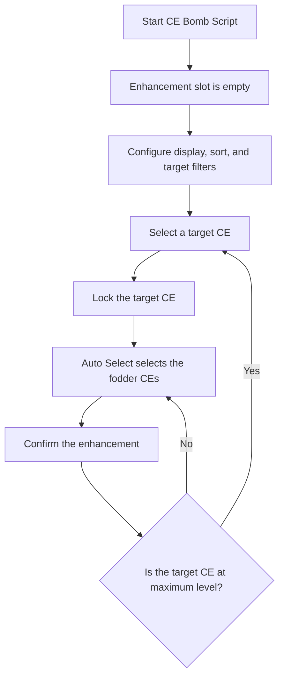

# Auto CE EXP Bomb

The script creates CE Bombs. It levels one CE after another in a loop.

## Overview

The script selects a target Craft Essence (CE) and feeds fodder CEs to it. When the target CE reaches its maximum level, the script selects the next target CE. It runs until you stop it, or until no fodder or target CEs remain.

## What is a CE Bomb?

A CE Bomb is a leveled CE that holds a large amount of CE experience. You feed many low-rarity CEs into one low-rarity CE. Later, you feed the bomb to a CE that you want to level. The bomb transfers the experience in one enhancement.

## How to Start

1. Open **Enhancement → Craft Essence** in the game.
2. Leave the enhancement slot empty. Do not select a CE.
3. Open the CE setup screen in FGA Preview. Set the target and fodder settings.
4. Start the script.

The script starts in CE Bomb mode when the enhancement slot is empty.

> [!TIP]
> **Important**
>
> The enhancement slot must be empty. With a CE in the slot, the script starts Level CE mode instead. See [Auto Level CE](auto-level-ce.md).

## Workflow



The loop runs until one of these occurs:

- No fodder CE matches your filter settings.
- The script finds no target CE.
- You stop the script.

## Key Features

### Continuous Target Selection

- The script selects a new target CE after each maxed target CE.
- On the first pass, the script configures the display size, the sort options, and the target filters.
- The target filters use your **Target Rarity** and **Target Filter CE Type** settings.
- The script scans a grid of 4 rows and 7 columns to find a target CE.

### Auto-Lock Protection

- The script locks each target CE with a long press. The long press needs Android 8.0 or later.
- The lock protects the target CE from use as fodder.
- Enable **Skip the auto-lock of target CE?** to skip this step.

### Auto Select Fodder

- The game selects the fodder CEs with its Auto Select feature.
- On the first pass, the script configures the Auto Select filter. It uses your **Fodder Rarity** and **Fodder Filter CE Type** settings.
- Later passes reuse this filter.

### Sort Setup

- On the first pass, the script enables Smart Sort, Select Sort, and Sort by Level.
- Enable **Skip the CE sort settings setup?** to skip this step. Then configure the sort options in the game yourself.

### Auto-Fill

- The script enables the auto-fill toggle in the Auto Select window.
- Later enhancements run with fewer steps. The script taps Enhance and waits for the Ok dialog.

### Connection Retry

- The game may lose the connection. The script retries the connection and continues.

## Settings

| Setting                            | Description                                                                           |
| ---------------------------------- | ------------------------------------------------------------------------------------- |
| Target Rarity                      | The CE rarity that the script uses as the bomb base.                                  |
| Target Filter CE Type              | The CE types that the target filter includes.                                         |
| Fodder Rarity                      | The CE rarities that the script uses as fodder.                                       |
| Fodder Filter CE Type              | The CE types that the Auto Select filter includes.                                    |
| Skip the auto-lock of target CE?   | The script does not lock the target CE.                                               |
| Skip the CE sort settings setup?   | The script does not configure the sort options. Configure them in the game yourself.  |
| Skip the CE filter settings setup? | The script does not configure the target and fodder filters. Configure them in the game yourself. |


## Exit Reasons

The script stops with one of these messages:

| Exit Message                     | Description                                                   |
| -------------------------------- | ------------------------------------------------------------- |
| `No fodder CE found`             | No fodder CE matches your filter settings.                    |
| `No suitable target CE found`    | The script scanned the CE list and found no usable target CE. |

## Differences from Level CE Mode

See [Auto Level CE](auto-level-ce.md) for the other mode.

| Feature        | CE Bomb                        | Level CE                        |
| -------------- | ------------------------------ | ------------------------------- |
| Target CE      | The script selects it          | You select it before you start  |
| Start state    | Empty slot                     | CE in the slot                  |
| Stop condition | No fodder or no target CEs     | Target CE at maximum level      |
| Runs           | In a loop, many CEs            | One CE                          |

## Recommended CE Bomb Strategy

### Use 1★ CEs as Bombs

1. Set **Target Rarity** to 1★.
2. Set **Fodder Rarity** to 1★ and 2★.
3. Set **Fodder Filter CE Type** to Normal.
4. Start the script. The script levels several 1★ CEs to maximum level.
5. Feed these 1★ bombs to your 4★ and 5★ CEs.

### Experience Efficiency

```text
1★ and 2★ CEs --> 1★ CE (bomb) --> Your 5★ CE
```

- The bomb transfers the experience of many fodder CEs in one enhancement.
- Bombs keep your CE inventory small.

## Tips for Best Results

1. Start with an empty enhancement slot.
2. Use 1★ CEs as the target rarity. This is the usual bomb setup.
3. Keep many fodder CEs in your inventory before you start a long run.
4. Check your QP. Each enhancement costs QP.
5. Check the locked CEs after the run. The script locks every target CE.

## Integration with FP Gacha

The Friend Point Gacha script can start CE Bomb mode after a summon:

```text
FP Gacha --> Inventory full --> CE Bomb mode
```

1. Enable **Create CE Bomb after summon** in the Friend Point Gacha settings. This setting is off by default.
2. The Friend Point Gacha script runs until the CE inventory is full.
3. The script then opens the CE Enhancement screen and starts CE Bomb mode.

This loop keeps your inventory small:

1. Summon with Friend Points to get fodder CEs.
2. Turn the fodder CEs into CE Bombs.
3. Continue summoning with the free space.

## Technical Notes

- The script detects the mode with the state of the enhancement slot.
- The first target selection includes the display size, the sort options, and the target filters. Later target selections skip this setup.
- The script scans a grid of 4 rows and 7 columns to find a target CE.
- The first fodder selection configures the Auto Select filter. Later fodder selections skip this setup.
- The script enables the auto-fill toggle. Later enhancements need fewer script actions.
- The script taps the Skip button while an enhancement runs.
- The script retries the connection automatically.
