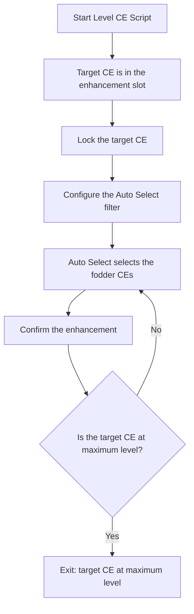

# Auto Level CE

The script enhances one target Craft Essence (CE) with fodder CEs. It stops when the target CE reaches its maximum level.

## Overview

The script feeds fodder CEs to the target CE that you selected before you started. The game selects the fodder CEs with its Auto Select feature. The script stops when the target CE reaches its maximum level.

This script has two modes. An empty enhancement slot starts CE Bomb mode. See [Auto CE EXP Bomb](auto-ce-exp-bomb.md).

## How to Start

1. Open **Enhancement → Craft Essence** in the game.
2. Select the CE that you want to level. The CE appears in the enhancement slot.
3. Open the CE setup screen in FGA Preview. Set the fodder settings.
4. Start the script.

The script starts in Level CE mode when the slot contains a CE.

> [!TIP]
> **Important**
>
> Select a target CE before you start the script. With an empty slot, the script starts CE Bomb mode instead.

## Workflow

The lock and the filter configuration run once, on the first pass. Later passes reuse the filter.

## Key Features

### Auto-Lock Target CE

- The script locks the target CE with a long press. The long press needs Android 8.0 or later.
- The lock protects the target CE from use as fodder.
- Enable **Skip the auto-lock of target CE?** to skip this step.

### Auto Select Fodder

- The game selects the fodder CEs with its Auto Select feature.
- On the first pass, the script configures the Auto Select filter. It uses your **Fodder Rarity** and **Fodder Filter CE Type** settings.
- Later passes reuse this filter.

### Auto-Fill

- The script enables the auto-fill toggle in the Auto Select window.
- Later enhancements run with fewer steps. The script taps Enhance and waits for the Ok dialog.

### Connection Retry

- The game may lose the connection. The script retries the connection and continues.

## Settings

The CE setup screen has these settings. **Target Rarity** and **Target Filter CE Type** appear only in CE Bomb mode.

| Setting                         | Description                                                                      |
| ------------------------------- | -------------------------------------------------------------------------------- |
| Fodder Rarity                   | The CE rarities that the script uses as fodder.                                  |
| Fodder Filter CE Type           | The CE types that the Auto Select filter includes.                               |
| Skip the auto-lock of target CE? | The script does not lock the target CE.                                         |
| Skip the CE filter settings setup? | The script does not configure the Auto Select filter. Configure the filter in the game yourself. |
| Skip the CE sort settings setup? | The script does not configure the sort options. This setting affects CE Bomb mode only. |

## Exit Reasons

The script stops with one of these messages:

| Exit Message                          | Description                                                      |
| ------------------------------------- | ---------------------------------------------------------------- |
| `Target CE have reached max level.`   | The target CE reached its maximum level. This is the normal end. |
| `No fodder CE found`                  | No fodder CE matches your filter settings.                       |

## Differences from CE Bomb Mode

See [Auto CE EXP Bomb](auto-ce-exp-bomb.md) for the other mode.

| Feature        | Level CE                        | CE Bomb                       |
| -------------- | ------------------------------- | ----------------------------- |
| Target CE      | You select it before you start  | The script selects it         |
| Start state    | CE in the slot                  | Empty slot                    |
| Stop condition | Target CE at maximum level      | No fodder or no target CEs    |
| Purpose        | Level one specific CE           | Make many leveled CEs         |

## Tips for Best Results

1. Select the target CE before you start the script.
2. Set **Fodder Rarity** to the CE rarities that you want to use as fodder.
3. Keep the auto-lock on. The lock protects the target CE.
4. Check your QP. Each enhancement costs QP.

## Technical Notes

- The script detects the mode with the state of the enhancement slot.
- The script does not change the display size, sort options, or target filters in Level CE mode.
- The script taps the Skip button while an enhancement runs.
- The script retries the connection automatically.
