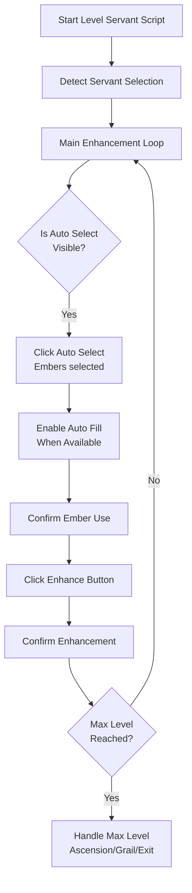

# Auto Level Servant

The Level Servant script increases the level of the selected servant with embers.

## Overview

The script feeds embers to the selected servant until the servant reaches the max level of the current stage. At max level, the script can redirect to the ascension menu. It can also redirect to the palingenesis (grail) menu.

## How to Start

1. Open **Enhancement → Servant** in the game.
2. Select the servant that you want to level.
3. Start the script.

FGA detects the enhancement mode by the **Auto Select** button or by the ascension or grail banner.

> [!TIP]
> **Important**
>
> Select a servant before you start. The script exits when the enhancement slot is empty.


## Workflow



## Key Features

### Auto Select Enhancement

- The script clicks the game's **Auto Select** button.
- The game then selects the embers.

### Auto-Fill and Refund Prompt

Some servers have the reworked enhancement screen. On these servers:

- The ember selection dialog shows an auto-fill toggle. The script enables the toggle. Auto-fill makes the enhancement faster.
- After the enhancement, the game refunds the unused embers and QP. The refund shows a prompt. The script closes the prompt and continues.
- A second prompt means the script has no embers or QP. The script then exits.

Servers without the reworked enhancement screen show no toggle and no refund prompt. The script skips these steps there.

### Max Level Handling

When the servant reaches max level, the script can do one of these actions:

1. **Redirect to Ascension** — the script opens the ascension menu. With the **Should Performed Ascension?** setting ON, the script also ascends the servant.
2. **Redirect to Palingenesis** — the script opens the palingenesis (grail) menu and stops.
3. **Exit** — the script stops at max level.

### Ascension Automation

- The script ascends the servant when you enable the ascension setting.
- After the ascension, the script returns to the enhancement menu and continues leveling.
- The script handles the dialog that appears at the third ascension.

### Grail Automation

- The script does not grail the servant. There is no plan to add it.
- After you grail the servant, start the script again to continue leveling.

### Temporary Servant Support

- The script detects temporary (story support) servants.
- Temporary servants get an additional confirmation dialog. The script confirms the dialog.

## Settings

The setup screen shows these settings:

| Setting                                               | Description                                                                                                                             |
| ----------------------------------------------------- | --------------------------------------------------------------------------------------------------------------------------------------- |
| Redirect to Ascension upon reaching the level cap?     | The script opens the ascension menu at max level.                                                                                        |
| Should Performed Ascension?                            | The script ascends the servant after the redirect. This setting needs the ascension redirect. Ascension of duplicate servants is not supported. |
| Redirect to Palingenesis upon reaching the level cap?  | The script opens the palingenesis (grail) menu at max level.                                                                             |
| Mute Notifications?                                    | The script mutes the enhancement notification popups while leveling.                                                                     |


## Exit Reasons

The script stops and shows a notification with one of these reasons:

| Exit Reason                     | Description                                                                  |
| ------------------------------- | ---------------------------------------------------------------------------- |
| **No Servant Selected**         | No servant is in the enhancement slot.                                       |
| **No Embers or QP Left**        | The script has no embers or QP left.                                         |
| **Max Level Achieved**          | The servant reached max level. No redirect setting is on.                    |
| **Redirect Ascension**          | The script opened the ascension menu. The ascension setting is off.          |
| **Unable to Perform Ascension** | The script could not complete the ascension.                                 |
| **Redirect Grail**              | The script opened the palingenesis (grail) menu.                             |
| **Perform Grail**               | The script was in the grail menu and could not return to the servant menu.   |
| **Abort**                       | You stopped the script manually.                                             |
| **Unexpected**                  | An unexpected error occurred.                                                |

## Workflow with Ascension

```text
┌─────────────────────────────────────────┐
│      Servant Reaches Max Level          │
└─────────────────────┬───────────────────┘
                      │
                      ▼
┌─────────────────────────────────────────┐
│  Is "Redirect to Ascension" Enabled?    │
└─────────────────────┬───────────────────┘
                      │
         ┌────────────┴────────────┐
         │ Yes                     │ No
         ▼                         ▼
┌─────────────────────┐   ┌─────────────────────┐
│ Navigate to         │   │ Check for Grail     │
│ Ascension Menu      │   │ Redirect            │
└─────────┬───────────┘   └─────────────────────┘
          │
          ▼
┌─────────────────────────────────────────┐
│  Is "Perform Ascension" Enabled?        │
└─────────────────────┬───────────────────┘
                      │
         ┌────────────┴────────────┐
         │ Yes                     │ No
         ▼                         ▼
┌─────────────────────┐   ┌─────────────────────┐
│ Click Enhance       │   │ Exit: Redirect      │
│ Confirm Ascension   │   │ Ascension           │
└─────────┬───────────┘   └─────────────────────┘
          │
          ▼
┌─────────────────────────────────────────┐
│    Return to Enhancement Menu           │
│    Continue Leveling                    │
└─────────────────────────────────────────┘
```

## Tips for Best Results

1. **Select the servant** before you start the script.
2. **Have enough embers** of the correct class.
3. **Have enough QP** for the enhancement cost.
4. **Enable the ascension settings** that you need.
5. **Auto-fill** makes the enhancement faster on servers with the reworked enhancement screen.

## Technical Notes

- The script retries the confirmation dialogs up to 5 times.
- The script detects connection errors and retries.
- The script detects the low QP dialog. It then clicks the auto select button for the minimum embers.
- The script detects the confirmation button automatically. The button is "Execute" or "Ok", depending on the server.
- The script uses color matching for the Auto Select button. The disabled button looks like a dimmed copy of the enabled button.
- The script supports regular servants and temporary servants.
- Debug mode may prevent the redirect detection. The debug rectangles obstruct the screen, and the script cannot detect the ascension or grail menu.
