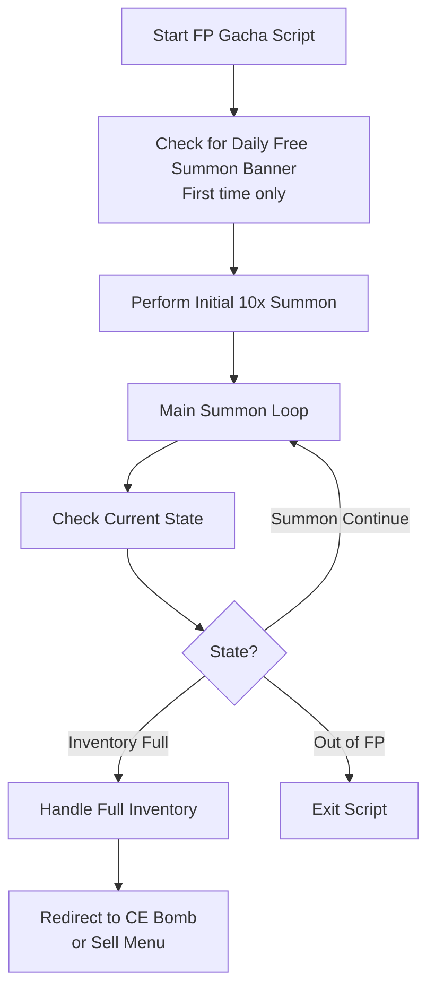

# Friend Point Gacha

Runs Friend Point (FP) summons automatically in the Friend Point gacha screen.

## Overview

The Friend Point Gacha script triggers 100x summons continuously with Friend Points. It manages your inventory. When the inventory becomes full, it can redirect to selling or CE enhancement.

## How to Start

1. Open the **Friend Point Summon** screen in the game
2. The script detects the FP summon screen when one of these appears:
   - The "Friend Summon" banner on the initial summon screen
   - The continue summon button after your first summon

## Workflow

## Key Features

### Summon Limit

- **Optional FP limit**: Set a maximum number of summons
- When the script reaches the limit, it can stop or open the sell menu

### Inventory Full Handling

When the inventory becomes full, the script can:

1. **Redirect to CE Enhancement** - Create CE bombs with the summoned CEs
2. **Redirect to Sell Menu** - Sell unwanted cards
3. **Stop the script** - Exit with an inventory full notification

### Connection Retry

- Handles connection issues automatically
- Retries when network errors occur

## Settings

| Setting          | Description                                                           |
| ---------------- | --------------------------------------------------------------------- |
| Limit FP         | Enable/disable summon limit                                           |
| FP Limit Count   | Maximum number of summons before stopping                             |
| Redirect to Sell | Open the sell menu when the limit is reached or the inventory is full |
| Create CE Bomb   | Open CE enhancement when the inventory is full                        |

## Exit Reasons

The script stops and notifies you when one of these conditions occurs:

| Exit Reason                              | Description                                                            |
| ---------------------------------------- | ---------------------------------------------------------------------- |
| **Inventory Full**                       | Your inventory is full and no redirect option is enabled               |
| **Run Out of Friend Points**             | No Friend Points remain for summoning                                  |
| **Summon Limit Reached**                 | The script reached the configured summon limit                         |
| **Reached Sell Banner**                  | The script reached the sell menu                                       |
| **Unable to Verify CE Enhancement Menu** | The script could not open CE enhancement after the inventory filled up |
| **Sell Banner Not Visible**              | The script expected the sell menu but did not detect it                |

## Tips for Best Results

1. **Clear inventory space** before you start for longer runs
2. **Enable redirect options** to summon more efficiently
3. **Set appropriate limits** if you want controlled summon sessions
4. **Make sure your connection is stable** for uninterrupted summoning
