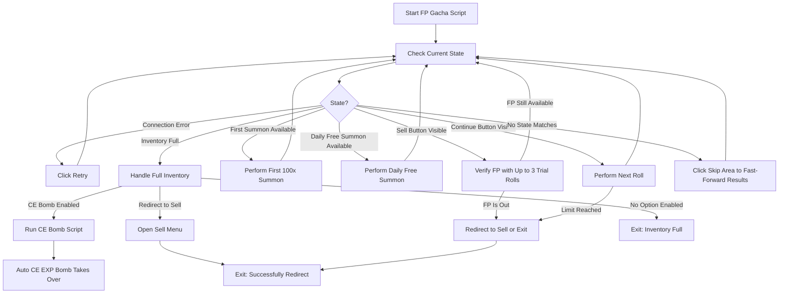

# Friend Point Gacha

Runs Friend Point (FP) summons automatically in the Friend Point gacha screen.

## Overview

The script performs FP summons continuously. It uses the 10x and 100x summon buttons. It counts each summon press as one roll. When your inventory becomes full, the script can open the sell menu or the CE Enhancement screen.

## How to Start

1. Open the **Friend Point Summon** screen in the game
2. The script detects the screen when one of these appears:
   - The Friend Summon banner (first summon or daily free summon)
   - The 10x or 100x continue summon button
   - The Sell button

## Workflow

The script detects the states in the order shown. The first match wins.

## Key Features

### Roll Limit

- The **Limit number of rolls** setting stops the script after a set number of rolls. You can set a value from 1 to 999. The default value is 1
- A roll is one summon press. Each 10x or 100x summon counts as one roll
- When the script reaches the limit, it opens the sell menu if **Redirect to Sell** is on. Otherwise, it stops and shows a "Rolled N times" notification

> [!NOTE]
> The roll limit and the CE bomb option cannot be on at the same time. When you enable the roll limit, the app turns off the CE bomb option.

### Inventory Full Handling

When the inventory becomes full, the script does one of these actions:

1. **CE Enhancement** - The script opens the CE Enhancement screen and runs the CE bomb script ([Auto CE EXP Bomb](auto-ce-exp-bomb.md))
2. **Sell Menu** - The script opens the sell menu
3. **Stop** - The script stops and shows an "Inventory Full." notification

The CE Enhancement option needs the CE bomb setting. The script uses this option only when the game shows the CE full notice. If the script cannot verify the CE Enhancement screen, it stops early.

> [!WARNING]
> **Redirect to Sell** and the CE bomb option are incompatible. Enable only one of them.

### Friend Point Verification

When you have no Friend Points left, the game shows the Sell button. The script then tries up to 3 more rolls to verify that no Friend Points remain.

- If a trial roll starts, Friend Points are still available. The script resumes summoning
- If no trial roll starts, the script opens the sell menu or stops with a "Ran out of Friend Points." notification

### Connection Retry

The script detects connection errors. It clicks the retry button automatically.

## Settings

The app stores these settings separately for each game server.

| Setting                                                                                   | Description                                                                              |
| ----------------------------------------------------------------------------------------- | ---------------------------------------------------------------------------------------- |
| Limit number of rolls                                                                     | Stop the script after a set number of rolls. The counter accepts values from 1 to 999    |
| Redirect to Sell after summon?                                                            | Open the sell menu when the script reaches the roll limit, when Friend Points are gone, or when the inventory is full |
| Should the CE bomb script run after the maximum limit of CEs has been reached? (EN/JP)    | Open CE enhancement when the inventory is full and the CE slots are full                 |

When you enable the CE bomb option, the app adds a collapsible **CE Bomb Settings** section. It contains the settings of the Auto CE EXP Bomb script.

## Exit Reasons

The script stops and notifies you when one of these conditions occurs:

| Exit Reason                              | Notification                                                            | Description                                                                     |
| ---------------------------------------- | ----------------------------------------------------------------------- | ------------------------------------------------------------------------------- |
| **Inventory Full**                       | "Inventory Full."                                                       | The inventory is full. No redirect option is on                                 |
| **Ran Out of Friend Points**             | "Ran out of Friend Points."                                             | No Friend Points remain. **Redirect to Sell** is off                            |
| **Roll Limit Reached**                   | "Rolled N times"                                                        | The script reached the roll limit. **Redirect to Sell** is off                  |
| **Reached Sell Banner**                  | "Successfully Redirect."                                                | The script opened the sell menu. This exit is normal                            |
| **Sell Banner Not Visible**              | "Unable verify the redirect."                                           | The script opened the sell menu but could not verify the sell banner            |
| **Unable to Verify CE Enhancement Menu** | "Unable to verify if reached the CE Enhancement Screen, exiting early"  | The script could not verify the CE Enhancement screen after the inventory became full |

> [!NOTE]
> The two sell exits can add the roll count or "Inventory Full." to the notification.

## Tips for Best Results

1. **Clear inventory space** before you start for longer runs
2. **Enable a redirect option** to keep the script running when the inventory is full
3. **Set a roll limit** if you want a controlled session
4. **Use a stable network connection** for fewer interruptions
