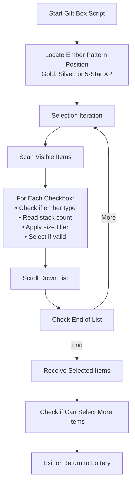

# Auto Gift Box (Present Box)

Automatically collects embers from the gift box (present box) with intelligent filtering.

## Overview

The Gift Box script selects and collects gold embers from your present box. It uses OCR to read stack sizes. It filters stacks by your preferences, so you collect only what you need.

## How to Start

1. Open the **Present Box** screen in the game
2. The script detects the gift box screen when:
   - Gold XP cards (embers) are visible in the list
   - Silver XP cards are visible
   - 5-star gold XP cards are visible
3. Make sure the gift box has items to collect

## Workflow



## Key Features

### Intelligent Ember Detection

- Identifies gold 4-star embers
- Identifies silver 3-star embers
- Identifies gold 5-star embers
- Uses OCR to read stack sizes (for example, "x50")

### Stack Size Filtering

- Selects only stacks within your configured maximum size
- Skips large stacks you want to keep

### Gold Ember Counting

- Tracks the total gold embers selected
- Stops when it reaches your configured limit

### Server-Specific Adjustments

- Adjusts detection regions for each game server
- Supports JP, EN, KR, TW, and CN servers

## Settings

| Setting                             | Description                                                   |
| ----------------------------------- | ------------------------------------------------------------- |
| Max Gold Ember Stack Size           | Maximum stack size to select (larger stacks skipped)          |
| Max Gold Ember Total Count          | Maximum total gold embers to collect                          |
| Loop Into Lottery After Present Box | Return to lottery after collection (when called from lottery) |


## Exit Reasons

The script stops and notifies you when one of these conditions occurs:

| Exit Reason                | Description                                                         |
| -------------------------- | ------------------------------------------------------------------- |
| **No Embers Found**        | The script found no embers in the gift box                          |
| **Cannot Select Any More** | The script reached the selection limit or found no more valid items |
| **Return to Lottery**      | The script collected the embers and returns to the lottery script   |

## Selection Algorithm

For each item in the gift box:

```text
┌─────────────────────────────────────────┐
│     Is Item Checkbox Visible?           │
└─────────────────────┬───────────────────┘
                      │ Yes
                      ▼
┌─────────────────────────────────────────┐
│   Check Icon Region for Ember Type      │
│   • Gold 4★ XP?                         │
│   • Silver 3★ XP?                       │
│   • Gold 5★ XP?                         │
└─────────────────────┬───────────────────┘
                      │ Ember Found
                      ▼
┌─────────────────────────────────────────┐
│   Read Stack Count Using OCR            │
│   (Extract number from "x50" etc.)      │
└─────────────────────┬───────────────────┘
                      │
                      ▼
┌─────────────────────────────────────────┐
│   Is Stack Size ≤ Max Stack Size?       │
└─────────────────────┬───────────────────┘
                      │ Yes
                      ▼
┌─────────────────────────────────────────┐
│   Select Item and Add to Count          │
└─────────────────────────────────────────┘
```

## Usage with Lottery

When the lottery script detects a full present box, it can automatically start the Gift Box script:

1. **Lottery detects a full present box**
2. **Opens the gift box**
3. **Gift Box script collects embers**
4. **Returns to lottery** (if enabled)
5. **Continues spinning**

## Tips for Best Results

1. **Set appropriate stack size limits** to skip large stacks you want to keep
2. **Set gold ember limits** to avoid collecting too many
3. **Clear non-ember items manually** if they block embers
4. **Make sure embers are visible** at the start of the gift box list

## Technical Notes

- The script selects at most 99 items per batch
- Uses 3 consecutive null checks to detect the end of the list
- Scrolls through the list to find all valid items
- Handles connection retries automatically
