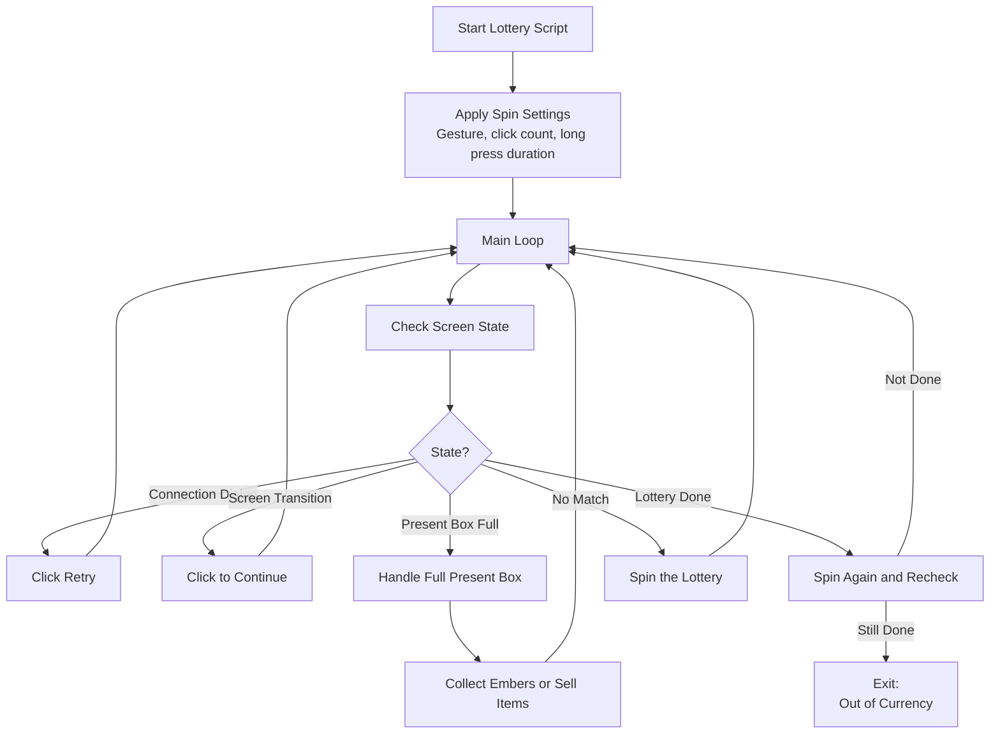
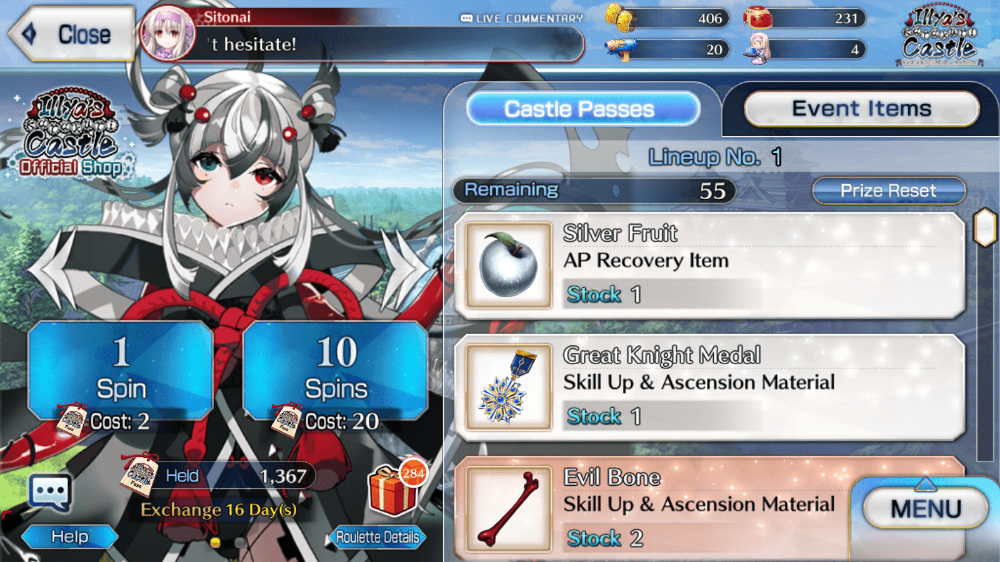
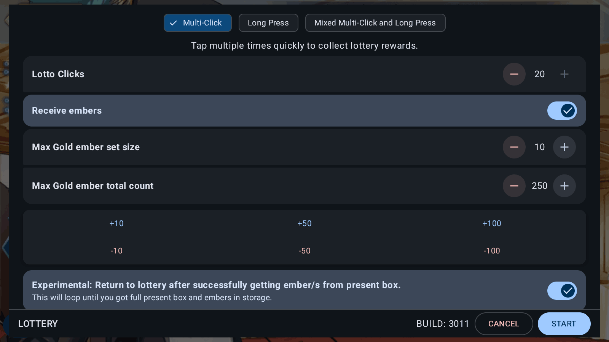
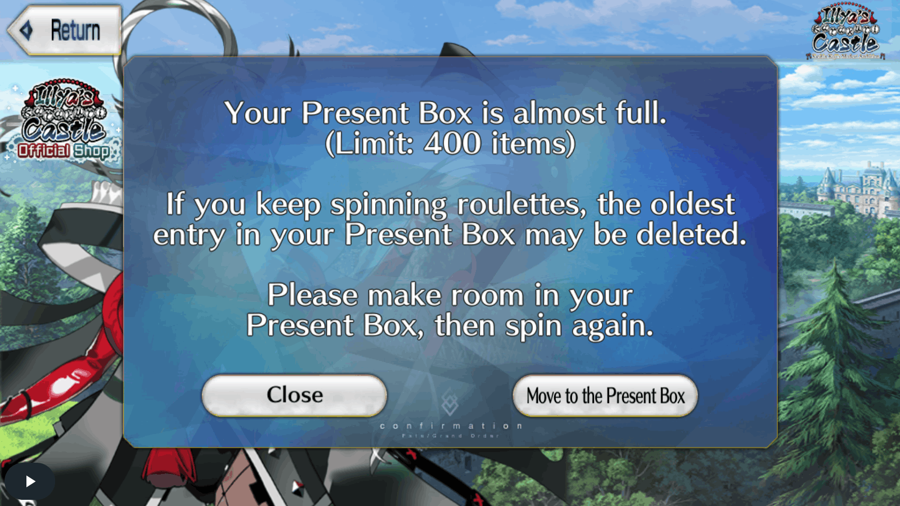
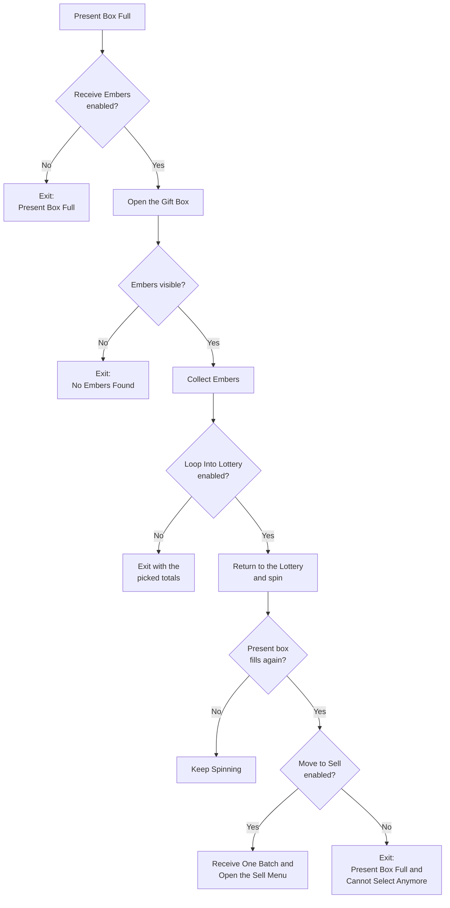

# Auto Lottery

The Auto Lottery script spins lottery boxes during Fate/Grand Order events and collects the rewards.

## Overview

The script spins the lottery box until the game shows the box as finished. When the present box becomes full, the script collects embers or opens the sell menu. The [Auto Gift Box](gift-box.md) script does the ember collection.

## How to Start

1. Open the **Event Lottery** screen in the game
2. Start the Auto Lottery script
3. The script detects the lottery screen when one of these indicators is visible:
   - The lottery cost indicator (JP and EN servers)
   - The lottery box finished indicator (other servers)
4. Make sure you have lottery currency (event items) to spend

## Workflow

## Key Features

### Spin Gestures

You select the gesture that presses the **Spin** button.

| Option | Behavior |
| --- | --- |
| **Multi-Click** | Taps the spin button several times. |
| **Long Press** | Presses and holds the spin button. |
| **Mixed** | Alternates two multi-click spins with one long press. |

> [!NOTE]
> All servers have the same gesture options. FGA stores your choice for each game server.

### Present Box Full Handling

When the present box becomes full, the script opens it and collects embers. The collection stops at your ember limits. After the collection, the script can return to the lottery and spin again. If the present box fills again, the script stops or opens the sell menu. The Present Box Full Flow section at the end of this page shows the complete flow.

### Lottery Completion Detection

The script double-checks when the lottery box looks finished:

1. The script spins again.
2. The script checks whether the finished indicator disappears.
3. If the indicator stays visible, the script stops with the Out of Currency notification.

### Connection Errors

The game sometimes shows a connection dialog. The script clicks **Retry** and waits for the game to load.

## Settings

You configure these settings in the lottery setup screen. The script stores them for each game server separately. The two ember limits appear when Receive Embers When Gift Box Full is on.

| Setting | Description |
| --- | --- |
| Lottery Gesture | The gesture that presses the Spin button. The default is Multi-Click. |
| Receive Embers When Gift Box Full | Collect embers automatically when the present box is full. |
| Loop Into Lottery After Present Box (Experimental) | Return to the lottery after the ember collection. |
| Move to Sell After Present Box (Experimental) | Open the sell menu when the present box fills again. This setting requires the two settings above. |
| Max Gold Ember Stack Size | Skip stacks with a count above this size. The default is 1. |
| Max Gold Ember Total Count | Stop the collection at this number of gold embers. The default is 100. |

## Spin Configuration

These two settings are global. They apply to all game servers. You can set them in the Fine Tune settings screen or in the lottery setup screen. The setup screen shows the sliders for the selected gesture.

| Setting | Range | Used By | Description |
| --- | --- | --- | --- |
| Lotto Clicks | 10 to 20, default 20 | Multi-Click, Mixed | Number of taps in one multi-click spin. |
| Lotto Long Press (in sec) | 10 to 30 seconds, default 10 | Long Press, Mixed | Hold time for one long press spin. |

> [!WARNING]
> A high click count can delay the stop request. Your phone may not accept presses while the taps run.

## Exit Reasons

The script stops and shows a notification when one of these conditions occurs:

| Exit Reason | Description |
| --- | --- |
| **Ran Out of Currency** | The finished indicator stays visible after the script spins and checks again. |
| **Present Box Full** | The present box is full and Receive Embers When Gift Box Full is off. |
| **No Embers Found** | The gift box contains no embers to collect. |
| **Cannot Select Any More** | The ember collection finished and Loop Into Lottery is off. The notification shows the picked stacks and gold embers. |
| **Present Box Full and Cannot Select Anymore** | The present box filled again during the collection and Move to Sell is off. The notification shows the picked totals. |
| **Reached Sell Banner** | The script reached the sell menu and stopped there. |
| **Sell Menu Not Found** | The script did not find the sell menu screen after the move to sell. |
| **Aborted** | You stopped the script. |

## Tips for Best Results

1. **Clear your present box before you start.** This gives you longer runs without interruptions.
2. **Set ember collection limits.** This avoids unnecessary inventory management.
3. **Show embers at the start of the gift box list.** The collection needs visible embers to start.
4. **Keep the click count near the default.** A high count can delay the stop request.

## Present Box Full Flow

