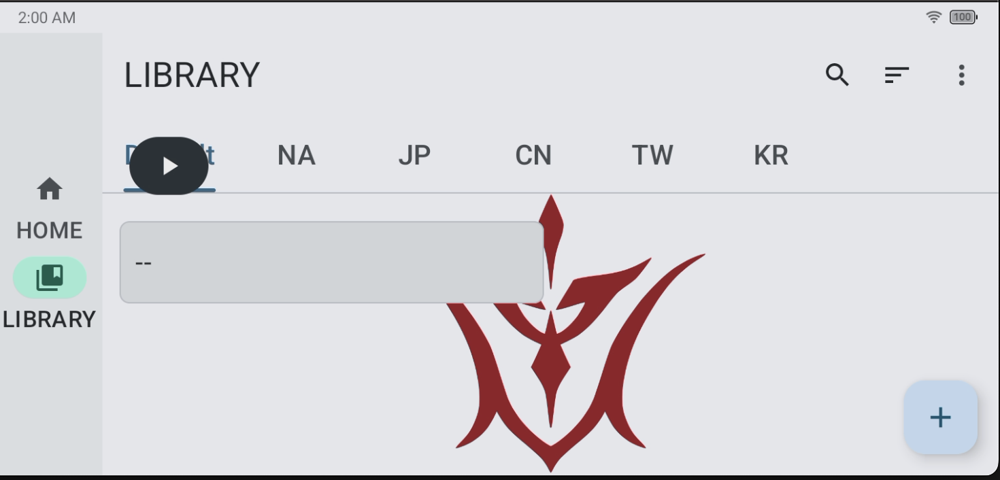
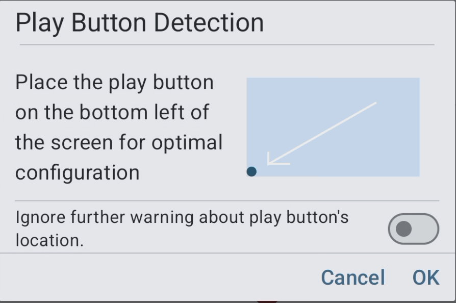

# Play Button Detection

## Overview

FGA Preview uses a floating play button to start and control automation scripts. The position of the button matters. It can accidentally cover areas of the game that FGA needs to see for accurate image matching.

The **Play Button Detection** feature checks the play button position when you start any script. If the button is in an unsafe position, FGA warns you before the script starts.

## Why Play Button Position Matters

FGA takes screenshots of your game and matches specific images to determine what happens on screen. If the play button covers these regions, the script may:

- Fail to detect buttons or menus correctly
- Miss important game elements during automation
- Behave unexpectedly or stop working

**The recommended position is the bottom-left corner of the screen.** There the button does not interfere with most game interfaces.

## Key Features

### Automatic Position Check

FGA checks the play button position every time you start a script. The check happens before the script runs, so you can fix problems immediately.

### Warning System

When the play button is not in the optimal position, FGA shows a warning dialog:

From this dialog, you can:

- **Move the play button** to the bottom-left corner and try again
- **Ignore the warning** if you understand the risks

### Ignore Future Warnings

You can keep the play button in a non-standard location. Enable the **"Ignore further warning about play button's location"** option. FGA then skips the position check for all later script runs.

You can also enable this setting permanently in **Settings > Advanced > Ignore warning about play button's location**.

## How to Move the Play Button

1. **Hold** the FGA play button (the floating circle on your screen)
2. **Drag** it to the bottom-left corner of your screen
3. **Release** to place it in the new position
4. Start your script again

## Tips for Best Results

1. **Place the button in the bottom-left corner** for maximum compatibility with all FGA features
2. **Keep the button near the screen edge** so it does not overlap game menus
3. **Test after moving** to make sure FGA can still detect game elements
4. **Avoid the center and right side** of the screen. These areas contain important game information

## Troubleshooting

### FGA keeps warning me about the play button position

**Solution**: Move the play button to the bottom-left corner of your screen. This is the safest position that works with all features.

### I moved the button but FGA still shows the warning

**Possible causes**:

- The button may not be far enough into the bottom-left region
- Try moving it closer to the corner

**Check points**:

- The button should be in the **left half** of the screen (horizontally)
- The button should be in the **lower 3/8** of the screen (vertically)

### Scripts work fine even though the button isn't in the bottom-left

Some scripts may work with any button position. Others may fail, especially when the button covers areas they use. For consistent results, keep the button in the recommended position.

### I enabled "Ignore warning" but now want to see warnings again

1. Open **Settings > Advanced**
2. Find **"Ignore warning about play button's location"**
3. Turn it **off** to see position warnings again
