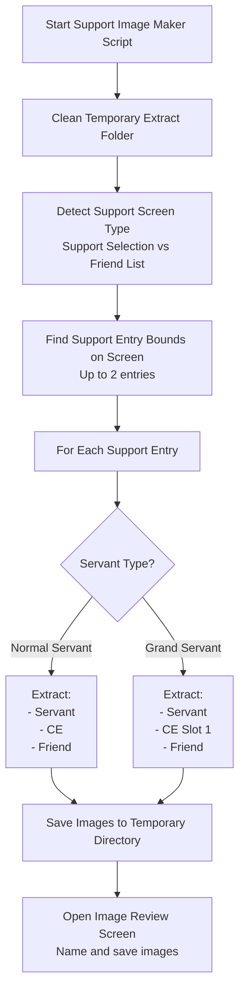

# Support Image Maker

Automatically extracts support servant, CE, and friend images from the support selection screen for support preferences.

## Overview

The Support Image Maker script captures images of support servants, Craft Essences (CEs), and friend names from the support selection screen. Use these images to configure support preferences for automated farming. FGA then selects specific servants or CEs during battle setup.

## How to Start

1. Open the **Support Selection** screen in the game (from quest start or friend list)
2. Make sure the support entries you want to capture are visible on screen
3. Start the Support Image Maker script
4. The script extracts images from up to 2 visible support entries

## Workflow

## Image Types

The script extracts three types of images from each support entry:

### Servant Image

- Captures the servant portrait from the support card
- Used to identify specific servants during support selection
- Recommended naming: `[Servant Name]/[Ascension]` (for example, `Waver/Final`)

### CE Image

- Captures the Craft Essence equipped on the support servant
- For Grand Servants: Extracts from CE Slot 1 position
- Used to select supports with specific CEs (for example, event bonus CEs)

### Friend Image

- Captures the friend/master name from the support card
- Used to prioritize specific friends on your support list
- Position differs between support selection and friend list screens

## Grand Servant Handling

Grand Servants have a different support card layout with multiple CE slots. The script:

1. Detects the Grand CE logo on the support card
2. Adjusts extraction coordinates for the Grand layout
3. Extracts CE from Slot 1 (top CE slot)
4. Uses Grand-specific friend name region

## After Extraction

When the script completes, the **Support Image Review** screen opens:

1. **Preview extracted images** - See all captured servant, CE, and friend images
2. **Enable/disable images** - Check the checkbox for images you want to save
3. **Name your images** - Enter descriptive names for organization:
   - Servant images: Enter servant name and ascension/costume
   - CE images: Enter CE name
   - Friend images: Enter friend's master name
4. **Save** - The app saves the images to your support image directory

### Naming Tips

- Use descriptive names for easy identification later
- For servants, include ascension or costume info
- Avoid special characters: `< > " | : * ? \ /`
- Names can include subdirectories with `/` (for example, `Waver/Bond CE`)

## Exit Reasons

| Exit Reason   | Description                                                                                           |
| ------------- | ------------------------------------------------------------------------------------------------------ |
| **Success**   | The script extracted the images. The review screen opens.                                               |
| **Not Found** | No support entries on screen. Make sure you are on the support selection screen with visible entries.   |

## Tips for Best Results

1. **Scroll to desired supports** - Position the servants you want to capture before starting
2. **Use clear support cards** - Avoid partially visible entries at screen edges
3. **Maximum 2 entries** - The script captures up to 2 support entries per run
4. **Re-run as needed** - Run the script multiple times to capture different supports
5. **Consistent naming** - Use consistent names for easier management

## Settings

This script has no configurable settings. It automatically:

- Detects the screen type (support selection vs friend list)
- Handles both normal and Grand servant layouts
- Saves to the app's support image temporary directory

## Related Features

After creating support images, use them in:

- **Battle Script** → Support Selection settings
- Configure preferred servants, CEs, and friends for automated farming
