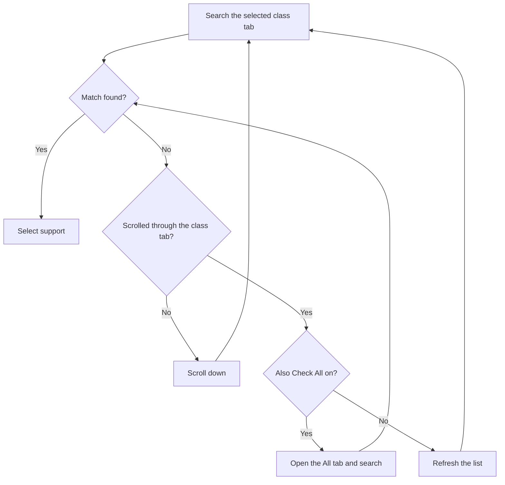

# Support Class Selection

This page describes how FGA searches a class tab on the support screen.

## Overview

The support screen in FGO groups servants by class tabs. FGA can open a specific class tab before it searches. This makes the search faster and more targeted.

## Key Features

- **Class tab navigation** - FGA opens the class tab that you select.
- **Also Check All** - FGA also searches the **All** tab when it finds no match.
- **Mix and Event support** - Target the event support tab.
- **Faster search** - A class tab reduces the search space.

---

## Available Class Options

| Class | Description |
|-------|-------------|
| **None** | Does not filter by class. FGA searches the current tab. |
| **All** | Searches the "All" tab. |
| **Saber** | Searches the Saber class tab. |
| **Archer** | Searches the Archer class tab. |
| **Lancer** | Searches the Lancer class tab. |
| **Rider** | Searches the Rider class tab. |
| **Caster** | Searches the Caster class tab. |
| **Assassin** | Searches the Assassin class tab. |
| **Berserker** | Searches the Berserker class tab. |
| **Extra** | Searches the Extra class (Ruler, Avenger, and similar classes). |
| **Mix** | Searches the Mix or Event tab. |

### Select a Class

1. Open a Battle Config.
2. Tap **Support Selection**.
3. Select your class in the **Support Class** list.

FGA opens the class tab after the support screen loads. FGA waits a short time for the tab to open.

!!! note
    When you select **None**, FGA does not open a class tab. It searches the tab that the game already shows.

---

## Also Check All

Turn on **Also Check All** to also search the **All** tab. FGA searches the **All** tab after it finds no match in the selected class tab.

### How Also Check All Works



### When Also Check All Is Available

The **Also Check All** option is available only for a real class tab.

| Class | Also Check All |
|-------|----------------|
| **None** | Not available |
| **All** | Not available |
| **Mix** | Not available |
| **Saber** through **Extra** | Available |

The option is not available for **None**, **All**, or **Mix** because:

- **None** - No class tab is selected.
- **All** - FGA already searches all classes.
- **Mix** - The event tab is separate from the class structure.

FGA searches the **All** tab one time. After it searches the **All** tab, it refreshes the list as usual.

---

## Strategies

### Target One Class

Use this when you know the class that you need.

```text
Support Class: Caster
Also Check All: Off
```

Use cases:

- Farming with a specific Caster damage dealer.
- A quest that needs a specific class.
- A setup that you use often.

### One Class With an All Fallback

Use this to prefer a class but still accept other classes.

```text
Support Class: Berserker
Also Check All: On
```

Use cases:

- You prefer a Berserker but accept other classes.
- Your servant can appear in different tabs.
- You want to balance speed and availability.

### No Class Filter

Use this to search the tab that the game shows.

```text
Support Class: None
```

Use cases:

- A servant that can be in any class.
- You open the tab yourself before you start.
- A simple setup with no class need.

### Search All Classes

```text
Support Class: All
```

Use cases:

- You look for a rare CE across all classes.
- The support setup matters more than the class.

### Event or Mix Tab

```text
Support Class: Mix
```

Use cases:

- Event farming that needs event supports.
- Campaign supports.
- Event CE hunting.

---

## Tips

- A class tab is faster than the **All** tab.
- Turn on **Also Check All** only when you accept other classes.
- Check the **Mix** tab for event support setups.
- Save a config for each class that you use often.

---

## Troubleshooting

### FGA opens the wrong class tab

- Check the **Support Class** setting in the config.
- FGA opens the tab after the support screen loads.

### Also Check All has no effect

- The option is available only for a real class tab.
- The option is not available for **None**, **All**, or **Mix**.
- Make sure that the option is on.

### The Mix tab does not open

- The Mix or Event tab may not show outside an event.
- Some servers use different tabs.
- Check the current FGO event schedule.

### FGA cannot find the support

- Use **Also Check All** to also search the **All** tab.
- Friends can put a servant in an unexpected tab.

---

## Related Documentation

- [Selection Modes](selection-modes.md) - Overview of selection modes
- [Support Refresh](refresh.md) - Refresh and scroll behavior
- [Preferred Servant Selection](preferred-servant.md) - Configure servant matching
