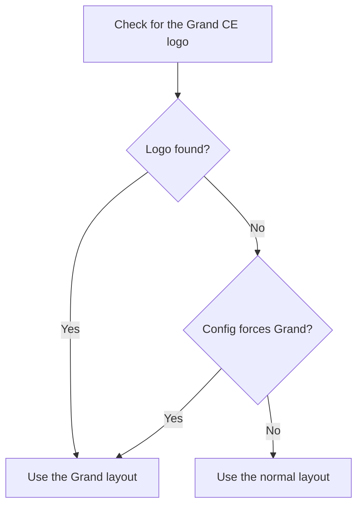

# Grand Servant Selection

This page describes how FGA detects and selects Grand servants on the Japanese (JP) server.

## Overview

A Grand servant is a JP server feature. A player can show one servant with higher support power. A Grand servant can equip up to three Craft Essences. It shows a special Grand indicator.

!!! warning "JP server and Grand Duels only"
    Grand servant features work on the JP server only. The Grand servant tag currently works in **Grand Duels** only. Use in a normal quest can return no match.

## Key Features

- **Grand detection** - FGA finds a Grand servant by its logo.
- **Level filter** - Target a Grand servant at level 100 or above level 100.
- **Three CE slots** - Configure preferences for all three CE slots.
- **Bond CE requirement** - Set the bond CE type for slot 2.
- **Automatic layout switch** - FGA changes the match regions for the Grand layout.

---

## Grand Servant Detection

FGA finds the Grand CE logo on the support card. The logo shows when a servant is set up as a Grand servant.

FGA treats an entry as a Grand servant when any of these is true:

| Condition | Description |
|-----------|-------------|
| **Grand CE logo** | FGA finds the Grand CE logo on the entry. |
| **Grand servant setting** | You set the Grand servant option for that servant. |
| **Grand CE configuration** | The CE configuration uses a Grand slot, such as slot 2 or slot 3. |

When FGA treats the entry as a Grand servant, it uses the Grand layout regions. The regions fit the Grand servant display.

!!! note
    On a server without Grand support, the Grand servant setting has no effect.

---

## Grand Servant Level Filter

Each servant has a **Grand Servant** setting. Use it to filter Grand servants by level.

| Option | Behavior |
|--------|----------|
| **Any Servant** | Accepts any servant. |
| **Any Grand Servant** | Accepts a Grand servant at level 100 or higher. |
| **Only Grand Servant Above Level 100** | Accepts a Grand servant above level 100. |

How FGA reads the level:

- FGA looks for the Grand servant logo and the above-100 logo next to the servant image.
- **Any Grand Servant** accepts the standard logo or the above-100 logo.
- **Only Grand Servant Above Level 100** accepts the above-100 logo only.

FGA checks the Grand servant level in the Grand layout only.

---

## Grand Servant CE Configuration

A Grand servant can equip up to three Craft Essences.

### Slot 1: Main CE

The primary CE slot. It works the same as the CE slot for a normal support.

| Setting | Description |
|---------|-------------|
| **CE entries** | The preferred CEs to match. |
| **MLB** | Each CE entry has its own Max-limit-broken switch. |

### Slot 2: Bond CE

The bond CE slot.

| Option | Behavior |
|--------|----------|
| **Skip** | Does not check slot 2. |
| **Any** | Accepts any bond CE. |
| **Bond CE** | Accepts a regular bond CE only. |
| **NP Charge** | Accepts an NP charge bond CE only. |

- **Regular bond CE** - The standard Bond 10 Craft Essence.
- **NP charge bond CE** - A bond CE that gives NP charge at the start.

!!! note
    FGA detects the bond CE by its icon, not by the full CE image. The similarity for the bond CE icon is 60 percent.

### Slot 3: Third CE

The third CE slot.

| Setting | Description |
|---------|-------------|
| **CE entries** | The preferred CEs, separate from slot 1. |
| **MLB** | Each CE entry has its own Max-limit-broken switch. |

Slot 3 has its own MLB switches, separate from slot 1. Use [Mana Prism shop CEs](https://fategrandorder.fandom.com/wiki/Category:Shop_Craft_Essences) in slot 3.

### Grand Servant CE Match

This setting combines the slot 1 result and the slot 3 result.

| Option | Behavior |
|--------|----------|
| **Match Both** | Slot 1 and slot 3 must both match. |
| **Match Either** | Slot 1 or slot 3 must match. |

See [Preferred CE Selection](preferred-ce.md#grand-servant-ce-match) for more detail.

---

## How Grand Servant Matching Works



When FGA uses the Grand layout, it runs these checks:

1. **Level check** - The Grand servant level meets the requirement.
2. **Slot 1 CE** - The main CE matches, and the MLB star shows when required.
3. **Slot 2 bond CE** - The bond CE type matches, unless the option is **Skip**.
4. **Slot 3 CE** - The third CE matches, and the MLB star shows when required.
5. **Standard checks** - The servant skills, ascension, and NP level still apply.

### Blank CE Detection

- Slot 1 checks for a blank CE in the normal layout only.
- Slot 2 uses a specific blank bond CE image for the Grand layout.
- The blank bond CE image is set for the JP server.

---

## Configuration Examples

### A grailed Grand servant

```text
Grand Servant: Only Grand Servant Above Level 100
Servant: [your preferred servant]
Max-ascended: On
Max Skills: 10 / 10 / 10
Slot 1 CE: [event CE], MLB: On
Slot 2 bond CE: Any
Slot 3 CE: [support CE], MLB: Off
```

### Any Grand servant with a charge bond CE

```text
Grand Servant: Any Grand Servant
Servant: [your preferred servant]
Slot 1 CE: [event CE], MLB: Off
Slot 2 bond CE: NP Charge
Slot 3 CE: [empty]
```

### A setup that also accepts a normal support

```text
Grand Servant: Any Servant
Servant: [your preferred servant]
Max Skills: X / 10 / X
Slot 1 CE: [event CE], MLB: On
```

---

## Tips

- Not all friends set up a Grand servant. Keep a normal servant as a fallback.
- **Any Grand Servant** gives more matches than **Only Grand Servant Above Level 100**.
- Use **Any** for the bond CE to raise the number of matches.
- Each slot must match for FGA to select the support.

---

## Troubleshooting

### The Grand servant options do not show

- Grand servant is a JP server feature.
- Make sure that your Battle Config uses the JP server.

### FGA does not detect the Grand servant

- The Grand CE logo must be visible on the support card.
- The friend may not have set up a Grand servant.
- Try **Any Servant** to also accept a normal support.

### The bond CE does not match

- Bond CE detection uses the icon at 60 percent similarity.
- Try **Any** instead of a specific bond CE type.

### Slot 3 is not checked

- Make sure that you configure CEs in slot 3.
- Slot 3 applies to Grand servants only.

### The level filter fails

- A servant above level 100 uses a different logo.
- **Any Grand Servant** accepts both the level 100 logo and the above-100 logo.
- **Only Grand Servant Above Level 100** accepts the above-100 logo only.

---

## Related Documentation

- [Preferred Servant Selection](preferred-servant.md) - Standard servant configuration
- [Preferred CE Selection](preferred-ce.md) - CE matching details
- [Support Selection Modes](selection-modes.md) - Overall selection configuration
