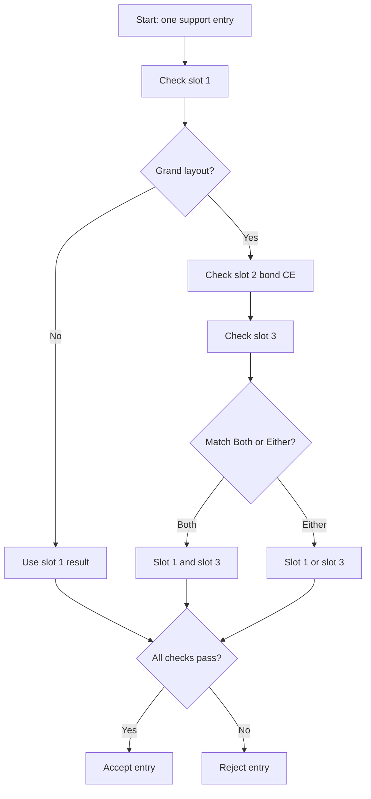

# Preferred CE Selection

This page describes how FGA finds and selects a support that equips your preferred Craft Essences (CEs).

## Overview

Preferred CE selection tells FGA which CEs a support must equip. FGA scans the CE area of each support entry and compares it to your CE entries.

A CE entry can come from two sources:

| Source | What it needs |
|--------|---------------|
| Atlas | No image on your device. FGA resolves the CE faces from the `fga-data` snapshot. |
| Stored image | An image in your support images folder. Make the image with the Support Image Maker. |

Each CE entry has its own Max-limit-broken (MLB) switch and its own matching settings.

## Key Features

- **Atlas and image support** - Add a CE from the atlas or from a stored image.
- **Three CE slots** - Slot 1 for every support, slot 2 for the bond CE, slot 3 for Grand servants.
- **Per-CE MLB** - Each CE entry has its own MLB requirement.
- **Blank CE check** - FGA rejects a normal support that has no CE.
- **Bond CE check** - Require a specific bond CE type for a Grand servant.
- **Grand match strategy** - Choose whether slot 1 and slot 3 must both match or either can match.

---

## Default CE and Custom CE

- **Default Preferred Craft Essences** - FGA applies these CEs to every servant.
- **Custom Preferred Craft Essences** - FGA applies these CEs to one servant only.

Each servant has a **Default** page and a **Custom** page for CEs. Tap the toggle at the top to change the page. FGA saves your choice. Your custom data stays when you return to the **Default** page.

A servant uses its custom CE only when you turn on the custom CE option for that servant. Otherwise the servant uses the default CE.

---

## CE Slots

| Slot | Applies to | Contents |
|------|------------|----------|
| **Slot 1** | Every support | One or more preferred CEs. |
| **Slot 2** | Grand servants only | A bond CE requirement. |
| **Slot 3** | Grand servants only | One or more preferred CEs. |

The slot 2 and slot 3 settings show only on servers that support Grand servants.

### Slot 1

1. Tap **Add Preferred Support** in slot 1.
2. Pick a CE from the atlas list, or tap the support images icon to pick a stored image.
3. Tap the CE.

- FGA rejects a normal support that has a blank CE when you configure CEs in slot 1.
- In the Grand layout, the blank CE check does not apply.

### Slot 2 (Bond CE)

Slot 2 holds the bond CE requirement for a Grand servant.

| Option | Behavior |
|--------|----------|
| **Skip** | Does not check slot 2. |
| **Any** | Accepts any bond CE. |
| **Bond CE** | Accepts a regular bond CE only. |
| **NP Charge** | Accepts an NP charge bond CE only. |

FGA detects the bond CE by its icon, not by the full CE image. FGA uses a similarity of 60 percent for the bond CE icon.

- **Regular bond CE** - The standard Bond 10 Craft Essence.
- **NP charge bond CE** - A bond CE that gives NP charge at the start.

FGA first checks that slot 2 is not blank. Then it checks for the bond CE type.

### Slot 3

1. Tap **Add Preferred Support** in slot 3.
2. Pick a CE from the atlas list, or tap the support images icon to pick a stored image.
3. Tap the CE.

Slot 3 has its own CE entries and its own MLB switches. Use [Mana Prism shop CEs](https://fategrandorder.fandom.com/wiki/Category:Shop_Craft_Essences) in slot 3.

---

## Max Limit Break (MLB)

Each CE entry has its own **Max-limit broken** switch. Turn on the switch to require the MLB star for that CE.

- The switch applies to that CE only.
- The switch applies to that CE in slot 1 and in slot 3.
- Slot 3 has its own MLB switch, separate from slot 1.

FGA detects the MLB star next to the matched CE. In the Grand layout, FGA reads the star from an adjusted position for each slot.

---

## CE Matching

Each CE entry has its own matching settings.

| Setting | Behavior |
|---------|----------|
| **CE Matching** | Sets the matching mode for that CE. |
| **Override matching threshold** | Turns on a custom matching threshold for that CE. |
| **Matching Threshold** | Sets the threshold. Tap the reset control to return to the mode default. |

The matching modes are the same as for servants. See [Image Matching](preferred-servant.md#servant-image-matching).

---

## Grand Servant CE Match

This setting decides how FGA combines the slot 1 result and the slot 3 result. The setting applies to the default CE and to each custom CE.

| Option | Behavior |
|--------|----------|
| **Match Both** | Slot 1 and slot 3 must both match your preferred CEs. |
| **Match Either** | Slot 1 or slot 3 must match your preferred CEs. |

!!! note
    The control stays disabled until you configure CEs in slot 1 and slot 3. An empty slot always matches. So **Match Either** with an empty slot would pass without a real match.

---

## Send Friend Request on Default CE Match

This switch is in the default CE screen. It controls the friend request that follows a default CE match.

- The master switch **Enable Send Friend Request** must be on.
- The switch is on by default.

When FGA picks a support that uses the default CE, and the picked CE matches your default configuration, FGA sends the friend request. When the picked servant uses a custom CE, this switch has no effect on that pick.

FGA rejects the friend request when your friend list is full.

---

## How CE Matching Works

FGA checks all three slots for every entry. It combines the slot 1 and slot 3 results with the Grand match strategy. Slot 2 must also pass.

---

## Tips

- Add all event bonus CEs to raise the number of matches.
- Turn off MLB early in an event. MLB CEs are rare at the start.
- Use atlas entries. An atlas entry needs no image.
- Set the MLB switch on each CE that must be limit broken.

---

## Troubleshooting

### FGA does not match the CE

- Check that the CE is in the correct slot.
- Check the matching mode and threshold. Lower the threshold when the CE is visible but not found.
- Check the MLB switch. Turn it off when the CE may not be limit broken.
- For a stored image, make the image again with the Support Image Maker.

### MLB is not detected

- Make sure that the MLB star is visible on the support screen.
- Make sure that the MLB switch is on for that CE.

### The bond CE does not match

- Bond CE detection uses the icon at 60 percent similarity.
- Try **Any** instead of a specific bond CE type.
- Make sure that the bond CE icon is visible.

### Slot 3 is not checked

- Slot 3 applies to Grand servants only.
- Make sure that the config uses a server that supports Grand servants.
- Make sure that you configure CEs in slot 3.

---

## Related Documentation

- [Grand Servant Selection](grand-servant.md) - Complete Grand Servant configuration
- [Preferred Servant Selection](preferred-servant.md) - Configure servant matching
- [Support Image Maker](../other-scripts/support-image-maker.md) - Create CE images
