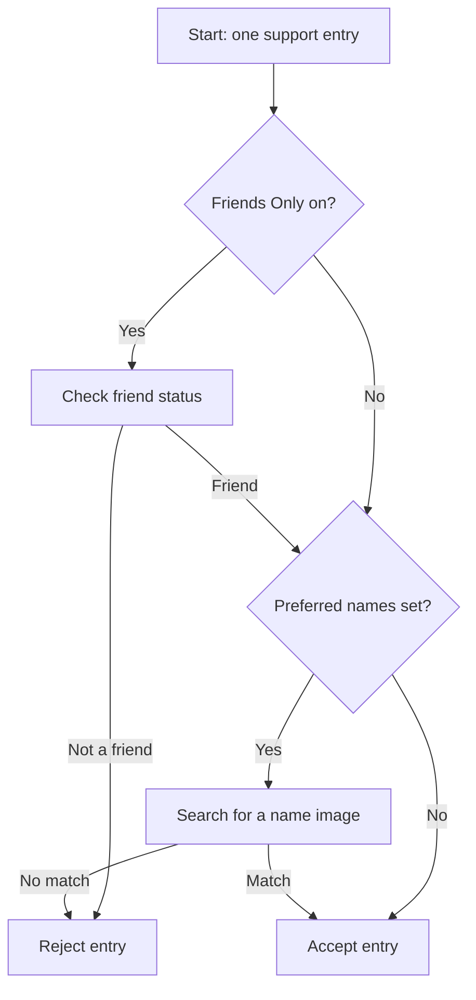

# Preferred Friend Selection

This page describes how FGA filters support selection by friend status and by preferred friend names.

## Overview

Preferred friend selection narrows support selection to your friends, or to specific friends by name. A friend support gives bonus Friend Points.

## Key Features

- **Friends Only** - Accept only supports from your friends list.
- **Preferred friends** - Accept only specific friends by name.
- **Friend status detection** - FGA recognizes friend, guest, and follow status.
- **Grand servant support** - Friend name matching works in the Grand layout.

---

## Default Friend and Custom Friend

- **Default Preferred Friends** - FGA applies these friend settings to every servant.
- **Custom Preferred Friends** - FGA applies these friend settings to one servant only.

Each servant has a **Default** page and a **Custom** page for friends, the same as the CE pages. A servant uses its custom friend settings only when you turn on the custom friend option for that servant.

---

## Friends Only

Turn on this switch to accept only supports from players on your friends list. FGA then rejects every support that is not from a friend.

### Friend Status Types

FGA recognizes three friend statuses.

| Status | Description |
|--------|-------------|
| **Friend** | A mutual friend. |
| **Guest** | A random player. FGA rejects a guest when **Friends Only** is on. |
| **Follow** | A player that you follow. FGA treats a follow the same as a friend. |

!!! note
    The friend names apply only when **Friends Only** is on. When the switch is off, FGA ignores the stored names and accepts any player.

---

## Preferred Friends

You can target specific friends by name.

1. Tap **Add Preferred Support** in the friend section.
2. Pick one or more friend name images.
3. Tap **Save**.

FGA requires a match on one of these names. When you set no name, FGA applies the **Friends Only** gate only.

### How Friend Name Matching Works

### Matching Priority

FGA applies the checks in this order:

1. The support must be a friend when **Friends Only** is on.
2. The support must match one of your preferred friend names when you set names.
3. The support must still match the servant and CE criteria.

---

## Grand Servant Friend Matching

For a Grand servant, FGA reads the friend name from a different region. The region fits the Grand layout. FGA picks the correct region for each entry, so friend name matching works in both layouts.

---

## Tips

- Use **Friends Only** alone for faster matching when any friend is acceptable.
- Capture friend names with the Support Image Maker. Include the full name.
- Recapture a friend name after the friend changes the name.
- Coordinate with friends for event CE setups.

---

## Troubleshooting

### FGA finds no friend

- Make sure that you have friends with the required class and servant.
- Refresh the list. Friends may not show at once.
- Check the friend status. Some entries can be follows or guests.

### A preferred friend is not selected

- The friend name image must match. Make the image again if the name changed.
- The servant and CE criteria must also match.

### A guest is selected

- Make sure that **Friends Only** is on.
- When **Friends Only** is off, FGA accepts any player.

### The preferred names have no effect

- The names apply only when **Friends Only** is on. Turn on the switch.

### Grand servant friend matching fails

- Make sure that the config uses the JP server.
- FGA reads the friend name from a different region in the Grand layout.

---

## Related Documentation

- [Support Selection Modes](selection-modes.md) - Choose the right selection mode
- [Preferred Servant Selection](preferred-servant.md) - Configure servant matching
- [Support Image Maker](../other-scripts/support-image-maker.md) - Create friend name images
