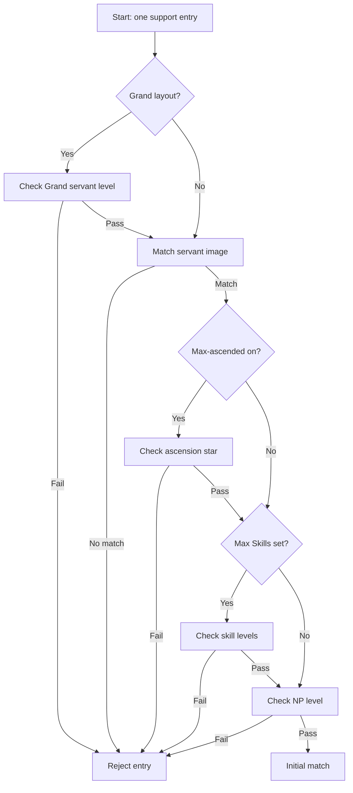

# Preferred Servant Selection

This page describes how FGA finds and selects a preferred support servant. It covers servant images, the per-servant filters, and image matching.

## Overview

Preferred servant selection tells FGA which servants to accept on the support screen. FGA scans each support entry. It compares the entry to your servant images and to the filters for that servant. FGA selects the first entry that meets every requirement.

A servant entry can come from two sources:

| Source | What it needs |
|--------|---------------|
| Atlas | No image on your device. FGA resolves the servant faces from the `fga-data` snapshot. |
| Stored image | An image in your support images folder. Make the image with the Support Image Maker. |

An atlas entry resolves all servant faces for that servant, such as each ascension, costume, and transform. This removes the need to capture a new image after the artwork changes.

## Key Features

- **Atlas and image support** - Add a servant from the atlas or from a stored image.
- **Per-servant filters** - Each servant has its own filters.
- **Ascension check** - Accept only servants that show the max-ascension star.
- **Skill and append checks** - Require skills and append skills at level 10.
- **NP level check** - Require a minimum Noble Phantasm level.
- **Per-entry matching** - Each servant has its own matching mode and threshold.
- **Multiple servants** - Accept any of the servants that you configure.

---

## Add a Servant

1. Open a Battle Config.
2. Tap **Support Selection**.
3. Select **Preferred** mode.
4. Tap **Preferred Support**.
5. Tap **Add** in the Preferred Servants section.
6. Pick a servant from the atlas list, or tap the support images icon to pick a stored image.
7. Tap the servant to add it. The detail screen opens.

The atlas list holds the servants from the `fga-data` snapshot. A stored image must already exist in your support images folder. Make stored images with the [Support Image Maker](../other-scripts/support-image-maker.md).

!!! note
    Preferred mode needs at least one enabled servant or one default Craft Essence. Friend settings alone do not start a search.

---

## Servant Settings

Each servant has its own settings. Tap the servant to open its detail screen.

| Setting | Behavior |
|---------|----------|
| **Use this Servant?** | Enables or disables this servant. A disabled servant stays in the config, but FGA does not search for it. |
| **Auto Send Friend Request** | Sends a friend request for this servant. The master switch must be on. |
| **Max-ascended** | Accepts only servants that show the golden ascension star. |
| **Max Skills** | Sets which of the three skills must be at level 10. |
| **Max Appends** | Turns on the append skill level check. |
| **Noble Phantasm** | Sets the minimum NP level from 1 to 5. |
| **Grand Servant** | Sets the Grand servant requirement. This setting shows only on servers that support Grand servants. |
| **Servant Matching** | Sets the image matching mode and threshold for this servant. |

### Max Skills

Tap a skill button to change the requirement for that skill.

| Display | Meaning |
|---------|---------|
| **10** | The skill must be maxed at level 10. |
| **X** | The skill level does not matter. |

For example, `10 / X / 10` means that skills 1 and 3 must be maxed. Skill 2 can be at any level.

FGA reads each skill level icon and compares it to the level 10 template. The skill template uses a similarity of 68 percent.

### Max Appends

Turn on this switch to check append skill levels. The editor has five append skill rows. Tap a row to require that append skill at level 10.

- The row shows **10** when you require that append skill.
- The row shows a dash when you do not require that append skill.

How FGA reads append skills:

- The support list shows either the skill levels or the append skill levels.
- FGA switches the list to the append display, reads every candidate under one screen snapshot, and then switches back to the skill display.
- FGA reads the five append skill level icons at the Japanese server positions on every server.
- FGA skips the check for an entry that shows the **Follow** indicator. A follow entry uses your own append skills, which do not apply.

### Noble Phantasm

Set the minimum NP level. FGA accepts a servant when its NP level is equal to or above this value.

| NP level | Meaning |
|----------|---------|
| **1** | Accepts any NP level. FGA does not read the NP text. |
| **2** | Accepts NP level 2 or higher. |
| **3** | Accepts NP level 3 or higher. |
| **4** | Accepts NP level 4 or higher. |
| **5** | Accepts NP level 5 only. |

- FGA reads the NP level from the support card with optical character recognition (OCR).
- FGA reads the NP level from a different region in the Grand layout.
- A failed read returns level 1. So a failed read fails the check only when you require level 2 or higher.

!!! warning "Server support limitation"
    NP level detection works on **English** and **Japanese** servers only.

!!! info "Read accuracy"
    The move from Tesseract to PaddleOCR improved the read accuracy. OCR can still read the NP level incorrectly when the image is not clear.

---

## Servant Image Matching

Each servant has its own matching settings. The settings apply to that servant only.

### Matching Mode

| Mode | How it works | Default similarity |
|------|--------------|--------------------|
| **Grayscale** | Converts both images to grayscale and uses normalized correlation. A higher score is better. | 80 percent |
| **Colored** | Keeps both images in color and uses normalized squared difference. A lower difference is better. | 95 percent |

### Threshold Override

Turn on **Override matching threshold** to set a custom threshold for this servant. Then drag the slider.

- The slider range depends on the mode.
- The **Grayscale** range is 50 to 100 percent.
- The **Colored** range is 80 to 100 percent.
- A higher value requires a closer match in both modes.
- A mode change resets the threshold to the default of the new mode.

!!! tip
    Lower the threshold when FGA cannot find a servant that you can see on the screen. Raise the threshold when FGA picks the wrong servant.

---

## How Servant Matching Works

FGA applies the servant filters in this order. FGA rejects the entry when a filter fails.

After FGA collects the initial matches, it runs the append skill check as a separate pass. See [Max Appends](#max-appends).

### Friend Lock Crop

When you lock a friend, a lock icon shows on the left of the servant image. The icon can cause the image match to fail. FGA crops the left edge of the servant image before it matches. This stops the lock icon from affecting the result.

### Ascension Star

FGA checks for the max-ascension star above the servant image. In the Grand layout, FGA reads the star from a lower position.

---

## Multiple Servants

You can add several servants. FGA accepts an entry when it matches any of the enabled servants.

FGA collects matches in screen order from top to bottom. The first match wins.

- The servant order in your config only decides which servant an entry belongs to.
- When more than one servant can match the same entry, the first servant in your config wins.

---

## Tips

- Use atlas entries. An atlas entry needs no image and covers every ascension and costume.
- Add more than one servant. Extra servants give fallback options.
- Set the filters on each servant. A filter applies to that servant only.
- Do not over-specify. Each extra filter reduces the number of matches.
- Test a strict setup on one quest before you start a long run.

---

## Troubleshooting

### FGA does not find the servant

- Check that the servant is enabled.
- Check the matching mode and threshold. Lower the threshold when the servant is visible but not found.
- Relax the filters. Turn off **Max-ascended**, **Max Skills**, or the NP level check.
- For a stored image, make the image again with the Support Image Maker.

### FGA picks the wrong servant

- Your image can match more than one servant.
- Raise the matching threshold.
- Add extra filter requirements.

### Skills are not detected

- Make sure that the screen is bright and the skill icons are clear.
- FGA compares each icon to the level 10 template at 68 percent similarity.

### Append skills fail

- Make sure that **Max Appends** is on and that you set the correct rows.
- FGA skips an entry that shows the **Follow** indicator.
- Make sure that the support list can switch to the append display.

### NP level always reads as 1

- NP level detection works on English and Japanese servers only.
- A failed read returns level 1. Make the image clear and raise the screen brightness.
- Make sure that the NP level text is fully visible.

---

## Related Documentation

- [Preferred CE Selection](preferred-ce.md) - Configure Craft Essence requirements
- [Preferred Friend Selection](preferred-friend.md) - Configure friend filtering
- [Grand Servant Selection](grand-servant.md) - JP server Grand Servant features
- [Support Image Maker](../other-scripts/support-image-maker.md) - Create support images
