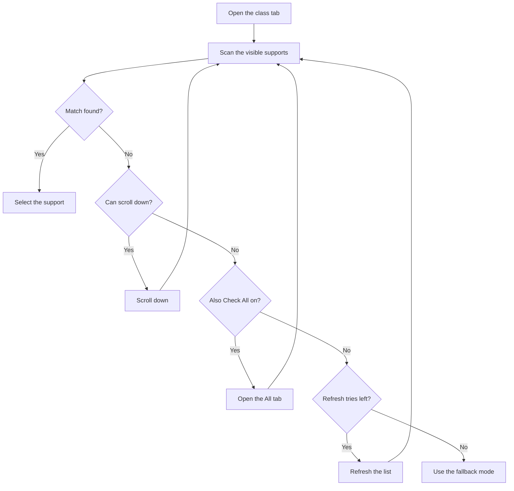

# Support Selection Modes

FGA Preview has three support selection modes. Each mode serves a different need.

## Overview

When FGA reaches the support screen, it must pick a support servant. The selection mode decides how FGA makes this choice.

| Mode | Description | Best for |
|------|-------------|----------|
| **First** | Selects the first support in the list. | Fast farming with no specific need. |
| **Manual** | Waits for you to pick the support. | Precise control and setup tests. |
| **Preferred** | Searches for your servants, CEs, or friends. | Farming with a specific support. |

---

## First Mode

First mode selects the first support in the list. It applies no filter.

### How First Mode Works

1. FGA waits for the support list to load.
2. FGA taps the first support entry.
3. FGA waits for the support screen to close.
4. FGA continues the battle when the screen closes.
5. FGA refreshes the list when the screen stays open. This happens when a friend sets no support.

### When to Use First Mode

- Farming quests where any support works.
- Event bonus supports when you want the most speed.
- Quick tests of an automation setup.

### Limits

- You cannot control which servant FGA selects.
- FGA cannot filter by friend status.
- FGA cannot check skills or NP level.

---

## Manual Mode

Manual mode waits on the support screen. You pick the support yourself.

### How Manual Mode Works

The behavior depends on the **Exit on Manual Support Selection** setting in the app settings.

| Setting | Behavior |
|---------|----------|
| **Off** (default) | FGA shows a toast and waits on the support screen. After you pick a support, FGA continues the battle automatically. |
| **On** | FGA pauses the script in place. The runner shows a notification. Resume the script to continue. |

In both cases, FGA confirms your selection after you pick a support. FGA continues the battle when the confirmation passes.

### When to Use Manual Mode

- A very specific support for hard content.
- Tests of different support setups.
- A quest that needs a human choice.

!!! note
    Manual mode stops the automatic pick. You must pick the support. The default setting keeps the script running after you pick. Turn on **Exit on Manual Support Selection** to pause the script instead.

---

## Preferred Mode

Preferred mode searches for your preferred servants, Craft Essences, and friends.

### How Preferred Mode Works

1. FGA loads your servant, CE, and friend settings.
2. FGA preloads the support images at the start of the run. A load error shows early.
3. FGA scans each visible support entry.
4. FGA checks each entry against all of your criteria.
5. FGA selects the first match in screen order.
6. FGA scrolls down when it finds no match.
7. FGA refreshes the list after it uses all scroll and refresh tries.

### Configure Preferred Mode

1. Open a Battle Config.
2. Tap **Support Selection**.
3. Select **Preferred** mode.
4. Tap **Preferred Support** to configure.

See the detailed guides:

- [Preferred Servant Selection](preferred-servant.md) - Configure servant matching
- [Preferred CE Selection](preferred-ce.md) - Configure Craft Essence matching
- [Preferred Friend Selection](preferred-friend.md) - Configure friend filtering
- [Grand Servant Selection](grand-servant.md) - JP server features

### Preferred Mode Needs a Criterion

Preferred mode needs at least one of these two items:

- One enabled servant.
- One default Craft Essence.

Friend settings only narrow an existing search. They do not start a search. When you set no servant and no CE, the script stops. The exit reason is `SupportSelectionPreferredNotSet`.

### Matching Logic

FGA selects a support only when it meets all enabled criteria.

| Criteria | Condition |
|----------|-----------|
| Servant | Matches any configured servant. |
| Ascension | Shows the max-ascension star, when **Max-ascended** is on. |
| Skills | The required skills are at level 10, when you set **Max Skills**. |
| Append skills | The required append skills are at level 10, when **Max Appends** is on. |
| Noble Phantasm | The NP level meets the minimum, when you set a level above 1. |
| Craft Essence | Matches any configured CE, or the CE is not blank. |
| MLB | The CE shows the limit break star, when you turn on MLB for that CE. |
| Friend status | The support is from a friend, when **Friends Only** is on. |
| Friend name | Matches a preferred friend, when you set friend names. |
| Grand servant | Meets the Grand level requirement, JP only. |

### Matching Priority

FGA collects matches in screen order from top to bottom. The first match wins.

- The servant order in your config only decides which servant an entry belongs to.
- When more than one servant can match the same entry, the first servant in your config wins.

### Search Behavior

### Append Skill Check

FGA reads each entry under one screen snapshot. It collects the entries that need an append skill check, and then it checks those entries in one pass. FGA switches the list to the append display once, reads every level, and switches back.

---

## Fallback Mode

Preferred mode uses a fallback mode when it finds no match after it uses all scroll and refresh tries.

Choose the fallback in the **Fallback** setting. The options are **First** and **Manual**. The default is **Manual**.

| Step | Behavior |
|------|----------|
| 1 | Preferred mode uses all scroll and refresh tries. |
| 2 | FGA runs the fallback mode. |
| 3 | When the fallback also finds no match, FGA runs manual selection. |

!!! tip
    Use **First** as the fallback to keep the run going with any support. Use **Manual** to stop and pick the support yourself.

---

## Choosing the Right Mode

| Scenario | Recommended mode |
|----------|-------------------|
| Daily farming with any servant | First |
| Event farming with specific CEs | Preferred |
| A hard quest with a specific support | Manual or Preferred |
| Speed tests of a battle config | First |
| Farming with Friend Points in mind | Preferred with **Friends Only** |

## Tips

- Configure your ideal support in Preferred mode first.
- Add more than one acceptable servant or CE for fallback.
- Use a class tab to reduce the search time.
- Turn on **Also Check All** for a backup when the class tab has no match.
- Raise the refresh and swipe limits when your requirements are strict.

---

## Troubleshooting

### The script keeps refreshing and selects nothing

- Your criteria can be too strict.
- Turn off optional checks, such as MLB, Max Skills, or the NP level.
- Make sure that your support images are correct.

### The script stops with SupportSelectionPreferredNotSet

- Add at least one enabled servant, or configure one default Craft Essence.
- Friend names alone do not start a search.

### First mode picks an empty support

- A friend can set no support.
- FGA refreshes the list and tries again.

### Manual mode does not continue

- You must pick the support.
- With the default setting, FGA continues after you pick.
- Turn on **Exit on Manual Support Selection** to pause the script instead.

---

## Related Documentation

- [Support Class Selection](class-picker.md) - Configure class tab filtering
- [Support List Refresh](refresh.md) - Understand refresh mechanics
